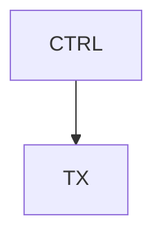

# docgen on macOS: setup and authoring guide

docgen builds a multi-section technical specification from markdown source files kept in git. One `make` produces a PDF with a cover page, table of contents, list of tables and list of figures, generated section numbers, running headers and footers with the confidentiality notice, figures from images and from Mermaid and WaveDrom sources, and a version-history page at the end. It also writes the whole document as one combined markdown file for other consumers. The pipeline is pandoc → Lua filters → XeLaTeX, driven by GNU make.

This guide is for Claude Code working in a VS Code integrated terminal on macOS (Apple silicon or Intel), with no Docker and no compute grid. It has three parts: Sections 1 to 4 install the tools, create the directory hierarchy and write the scripts; Section 5 gives the authoring rules for the documents (page breaks, keep-together behaviour, numbering, tables, figures, references); Appendix A holds the full source of every docgen file, to be written verbatim. Where this guide and the Linux `README.md` in Appendix A differ on tool setup, this guide wins on macOS.

## 1. Install the tools

Table 1-1 lists what docgen needs on `PATH`. The build stops with a message naming any tool that is missing (`make check-tools`).

| **Tool** | **Used for** | **Install** | **Minimum** |
| --- | --- | --- | --- |
| `pandoc` | markdown → LaTeX, runs the Lua filters | `brew install pandoc` | 3.1 (template written against 3.11) |
| `xelatex` | PDF engine | `brew install --cask basictex` + `tlmgr` packages | TeX Live 2018 |
| `mmdc` | Mermaid → PDF (headless Chrome) | `npm install -g @mermaid-js/mermaid-cli` | 11 |
| `wavedrom-cli` | WaveDrom → SVG | `npm install -g wavedrom-cli` | 3 |
| `rsvg-convert` | SVG → PDF | `brew install librsvg` | 2.42 |
| `python3` | three helper scripts, standard library only | ships with Xcode Command Line Tools | 3.9 |
| `make` | build driver | ships with Xcode Command Line Tools (3.81 works; `brew install make` gives 4.x as `gmake`) | 3.81 |
| `dot` | Graphviz figures (Section 6, optional) | `brew install graphviz` | 2.40 |

*Table 1-1: docgen tools on macOS.*

### 1.1 Homebrew and the shell

Check `brew --version`. If Homebrew is missing, install it with the one-line command from https://brew.sh, then make sure the shell picks it up: on Apple silicon `~/.zprofile` needs `eval "$(/opt/homebrew/bin/brew shellenv)"` (Intel: `/usr/local/bin/brew`). Every `brew install` below that adds a command needs a new terminal tab before the command is on `PATH`. VS Code's integrated terminal runs a login `zsh`, so it inherits the same `PATH` as Terminal.app once the profile is right; if a tool is missing in VS Code but present in Terminal.app, quit and relaunch VS Code.

### 1.2 Homebrew packages

```bash
brew install pandoc librsvg node graphviz fontconfig
```

`fontconfig` is only for `fc-list` (checking fonts). `node` gives `npm` for Section 1.4. `graphviz` is only needed for Section 6.

### 1.3 TeX Live

Install BasicTeX (about 100 MB) and add the packages the docgen template uses. Full MacTeX (`brew install --cask mactex-no-gui`, about 5 GB) also works and needs no `tlmgr` step.

```bash
brew install --cask basictex
eval "$(/usr/libexec/path_helper)"      # or open a new terminal: /Library/TeX/texbin is added via /etc/paths.d
sudo tlmgr update --self
sudo tlmgr install fancyhdr etoolbox booktabs multirow soul caption colortbl float ms ulem setspace \
    framed fancyvrb upquote microtype parskip fontspec unicode-math xcolor geometry hyperref bookmark \
    xurl footnotehyper titlesec chngcntr lm-math tex-gyre listings ucharcat mdwtools
xelatex --version | head -1
```

`tlmgr` reports packages that BasicTeX already has as already installed; that is fine. If a later build fails with `File 'x.sty' not found`, run `sudo tlmgr install x`.

### 1.4 Fonts

The defaults are Cantarell for body text, DejaVu Sans Mono for code and DejaVu Sans as the fallback for Greek letters and arrows. XeLaTeX finds fonts through the system font list, so install them as casks (they land in `~/Library/Fonts`, where Chrome for the Mermaid diagrams also sees them):

```bash
brew install --cask font-cantarell font-dejavu
fc-list | grep -i -E 'cantarell|dejavu' | head
```

If a cask is unavailable, set `mainfont`, `sansfont`, `monofont` and `fallbackfont` in `tools/docgen/defaults.yaml` to installed fonts (for example `Helvetica Neue`, `Helvetica Neue`, `Menlo`, `Helvetica Neue`). Keep the fonts the same across every host that builds the same document, or the page breaks move.

### 1.5 Node tools: mermaid-cli and wavedrom-cli

```bash
npm install -g @mermaid-js/mermaid-cli wavedrom-cli
mmdc --version
wavedrom-cli --help | head -3
```

Installing mermaid-cli downloads its own Chrome for Testing into `~/.cache/puppeteer`; this needs network access and must not be skipped (do not set `PUPPETEER_SKIP_DOWNLOAD`). If `mmdc` later reports that it cannot find a browser, run `npx puppeteer browsers install chrome`. No sandbox flags are needed on macOS; `docgen.mk` handles the two host differences (no puppeteer config file, and the `-f` flag that mermaid-cli 12 dropped) in its `Darwin` block.

The Linux container pins the `wavedrom` library under `wavedrom-cli` to 3.6.2 with an npm override. Do the same only if a WaveDrom figure renders differently from the Linux build:

```bash
mkdir -p ~/.local/wavedrom && cd ~/.local/wavedrom && npm init -y >/dev/null
npm pkg set "overrides.wavedrom=3.6.2" && npm install wavedrom-cli
ln -sf ~/.local/wavedrom/node_modules/.bin/wavedrom-cli "$(brew --prefix)/bin/wavedrom-cli"
```

### 1.6 Python and make

`python3 --version` must print 3.9 or newer; the macOS Command Line Tools version is enough, and the scripts import only the standard library. `make --version` prints GNU Make 3.81 on a stock Mac, which runs `docgen.mk`. If `brew install make` was done, `gmake` is 4.x; either works.

### 1.7 VS Code

Install the extensions that make the sources readable while editing; none is required by the build:

```bash
code --install-extension yzhang.markdown-all-in-one      # TOC, table formatting, preview
code --install-extension bierner.markdown-mermaid        # Mermaid fences in the preview
code --install-extension tomoki1207.pdf                  # open out/<DOC>.pdf inside VS Code
code --install-extension streetsidesoftware.code-spell-checker
```

Do not let an extension reformat tables on save: the dash counts in a table's separator row set the PDF column widths (Section 5.5). In Markdown All in One, leave "Table formatter" off, or exclude the document directories. Build and view with the integrated terminal: `make` then open `out/<DOC>.pdf` (the pdf extension re-renders on every rebuild).

### 1.8 Verify

Every line must print a version before going on:

```bash
pandoc --version | head -1          # pandoc 3.x
xelatex --version | head -1         # XeTeX 3.14... (TeX Live 20xx)
mmdc --version                      # 11.x or 12.x
wavedrom-cli --help >/dev/null && echo wavedrom ok
rsvg-convert --version              # rsvg-convert version 2.5x
python3 --version                   # 3.9+
fc-list | grep -c -i cantarell      # > 0
```

## 2. Hierarchy

docgen is one shared directory at the repository root plus one directory per document. The document directory can sit anywhere in the repository; its `Makefile` reaches `docgen.mk` by a relative path.

```
<repo>/
  tools/docgen/                 shared: build rules, template, filters, scripts (Appendix A)
    README.md
    docgen.mk                   included by every document Makefile
    defaults.yaml               default metadata (company, notice, fonts, page setup)
    puppeteer-config.json       Chromium options for mmdc on Linux; unused on macOS
    template/spec.latex         pandoc LaTeX template with the docgen additions
    filters/*.lua               pandoc Lua filters (page breaks, tables, figures, references, ...)
    bin/*.py                    strip_preamble, combine_sections, history_meta
  bin/render-figures            optional: Graphviz / Mermaid sources → committed SVG + PNG (Section 6)
  <area>/<block>/doc/           one directory per document, e.g. dig/design/chip/doc/
    Makefile                    DOC, SECTIONS, include <relative path>/tools/docgen/docgen.mk
    metadata.yaml               title, subtitle, header/footer text, options
    history.md                  version-history table, newest row first
    *.md                        section files, any names; SECTIONS gives the order
    img/                        images (png, svg, pdf) and Graphviz .dot sources with their renders
    wavedrom/                   WaveDrom JSON files referenced from wavedrom fences
    out/                        generated; gitignored
```

Add the generated directory to a `.gitignore` that covers every document, for example in `<area>/.gitignore`:

```gitignore
# docgen (tools/docgen) build output
design/*/doc/out/
```

Nothing under a document directory may name a user's home or work directory; image and WaveDrom paths are relative to the document directory.

## 3. Write the docgen files

1. Create the directories: `mkdir -p tools/docgen/{template,filters,bin}`.
2. Write every file in Appendix A to the path in its heading, byte for byte, including the comments. Table 3-1 says what each does so a build error can be traced.
3. The `docgen.mk` in Appendix A already carries the macOS block (`ifeq ($(shell uname -s),Darwin)`), which empties `MMDC_PUPPETEER_CONFIG` and sets `MMDC_PDF_FLAGS` from the installed mermaid-cli version. Keep `puppeteer-config.json` as written so the same tree builds on Linux.
4. No file needs the executable bit; make calls the Python scripts through `$(PYTHON)`.
5. Build the smoke document of Section 4 before writing any real content.

| **File** | **Role** |
| --- | --- |
| `docgen.mk` | Build rules: combine sections, pandoc → `.tex`, repeated `xelatex` passes, tool checks, `help`, `clean` |
| `defaults.yaml` | Default metadata; a document's `metadata.yaml` overrides any key |
| `template/spec.latex` | pandoc 3.11 `default.latex` plus the blocks marked `docgen:`: cover page, headers and footers, section page breaks, section-major table and figure numbers, keep-together macros, image bounding |
| `filters/headers.lua` | Expands `{page}` in header/footer metadata |
| `filters/pagebreak.lua` | Horizontal rule (`---`) → page break |
| `filters/history.lua` | Makes the version-history heading unnumbered and unlisted |
| `filters/diagrams.lua` | Renders `mermaid` / `wavedrom` fences to cached PDFs; `Figure:` / `Table:` captions with keys; rewrites `[Table](#key)` links to numbered references |
| `filters/images.lua` | Resolves image paths against `img/`; converts SVG images to PDF |
| `filters/fallback.lua` | Sets Greek letters and arrows in `fallbackfont` |
| `filters/tables.lua` | Typesets every table as a full-grid longtable; emits the keep-together measurement; sets `lot` / `lof` |
| `filters/columns.lua` | `<!-- columns N -->` … `<!-- columns end -->` → multi-column text |
| `filters/strip_heading_numbers.lua` | Optional (`STRIP_HEADING_NUMBERS=1`): removes hand-typed heading numbers from legacy sources |
| `bin/strip_preamble.py` | Drops everything above the first `#` heading of a section file |
| `bin/combine_sections.py` | Writes `out/<DOC>.md`, the sections joined verbatim with the notice and a provenance comment |
| `bin/history_meta.py` | Writes the newest history row's revision and date as cover-page metadata |
| `puppeteer-config.json` | Chromium launch options for `mmdc` on Linux (Docker); ignored on macOS |
| `README.md` | The Linux-oriented reference; keep it with the tree, and point its Section 1 at this guide for macOS |

*Table 3-1: docgen files and their roles.*

## 4. Create and build a document

```bash
mkdir -p dig/design/demo/doc/img dig/design/demo/doc/wavedrom && cd dig/design/demo/doc
```

`Makefile` (the include path is relative to the document directory; count the levels):

```make
DOC      := demo_spec
SECTIONS := overview.md
include ../../../../tools/docgen/docgen.mk
```

`metadata.yaml` (every key is optional; Table 4-1 lists them):

```yaml
title: Demo Block Specification
subtitle: Architecture and interfaces
# revision and date on the cover page come from the newest row of history.md
# footer-center: Anarel Confidential
# align-left: true
```

`history.md`:

```markdown
Anarel Confidential

Editor notes above the heading are not rendered. Newest version first; the cover page prints the first row.

# Version History

| **Rev** | **Date** | **Author** | **Description** |
| :-: | :-: | :-: | --- |
| R1 | 2026-10-21 | A. Author | Initial draft |
```

`overview.md`:

````markdown
Anarel Confidential

# Overview

The block does X. [Table](#blocks) lists its parts and [Figure](#hier) shows how they connect.

| **Block** | **Function** |
| --- | --- |
| CTRL | Sequencer |
| TX | Transmitter |

Table blocks: Top-level blocks.



Figure hier: Block hierarchy.
````

Build and open:

```bash
make            # out/demo_spec.pdf and out/demo_spec.md
open out/demo_spec.pdf
make md         # out/demo_spec.md only
make tex        # out/demo_spec.tex, to inspect the LaTeX
make versions   # tool versions
make clean      # remove out/
```

The build writes `out/<DOC>.md` first: every section file with its preamble removed, joined verbatim in `SECTIONS` order, headed by the notice line and a comment naming the title, revision and source files. That file has no cover, TOC, numbers or history and nothing in it is reformatted, so it is the diffable text deliverable; its references stay as `[Table](#key)`. pandoc turns it into `out/<DOC>.tex`, and `docgen.mk` runs `xelatex` until LaTeX stops asking for a rerun (table widths and the TOC need more passes than pandoc's own PDF step gives). The build prints the number of overfull lines when there are any; details are in `out/<DOC>.log`. Rendered diagrams are cached in `out/diagrams/` by content hash and SVG conversions in `out/images/`.

| **Key** | **Purpose** | **Default** |
| --- | --- | --- |
| `title`, `subtitle` | Cover page; `title` is also the default right header | — |
| `revision`, `date` | Cover page; taken from the newest row of `history.md`, never from `metadata.yaml` | — |
| `company` | Cover page | Anarel |
| `header-left`, `header-center`, `header-right` | Page header from page 2 on | `header-right` = title |
| `footer-left`, `footer-center`, `footer-right` | Page footer from page 2 on; the cover shows only `footer-center` | page number / Anarel Confidential / — |
| `section-newpage` | Every `#` section starts a new page | true |
| `align-left` | Flush-left body text instead of justified | false |
| `mainfont`, `sansfont`, `monofont`, `fallbackfont` | XeLaTeX fonts, by installed family name | Cantarell / Cantarell / DejaVu Sans Mono / DejaVu Sans |
| `diagram-font-size` | Nominal text size in Mermaid and WaveDrom diagrams, set in `mainfont` | 11pt |
| `table-header-color` | Header-row shading for every table, hex RGB; remove the key for none | DDEBF7 |
| `fontsize`, `papersize`, `geometry` | Page setup | 11pt, letter, margin=1in |
| `colorlinks`, `linkcolor`, `urlcolor` | Link colouring | true, NavyBlue |

*Table 4-1: metadata keys (`tools/docgen/defaults.yaml` holds the defaults).*

Write `{page}` anywhere in a header or footer slot to place the page number (`footer-right: "Page {page}"`). The cover is page 1 with its number hidden; numbering continues from 2. The confidentiality text appears in three places that must agree: `footer-center` in `defaults.yaml`, `NOTICE` in `docgen.mk` (the first line of the combined markdown), and the first line of every section file.

Makefile variables that can be set before the `include` or on the command line: `OUT`, `METADATA`, `HISTORY`, `TOC_DEPTH` (default 3), `DOC_DEPS` (extra files that trigger a rebuild; default `img/*` and `wavedrom/*`), `STRIP_HEADING_NUMBERS=1`, `PANDOC_EXTRA`, `NOTICE`, and the tool names `PANDOC`, `XELATEX`, `MMDC`, `WAVEDROM`, `RSVG_CONVERT`, `PYTHON`, `MMDC_PUPPETEER_CONFIG`, `MMDC_PDF_FLAGS`.

## 5. Authoring guidelines

### 5.1 Section files

- **Every section file and `history.md` starts with the line `Anarel Confidential`**, then a blank line, then any editor notes, then the first `#` heading. Everything above the first level-1 heading is dropped from the PDF, so the notice never renders twice, but a file read on its own still carries it. Put to-dos and notes to co-authors there, never content. A file with no `#` heading fails the build.
- **Several sections per file are fine.** Every `#` heading starts a new numbered section in file order; `SECTIONS` in the Makefile sets the file order. Split files by topic, so parallel edits do not collide.
- **One line per paragraph and per bullet.** Never hard-wrap prose; editors soft-wrap it, and hard wraps make diffs unreadable.
- Keep the source plain markdown that a WYSIWYG editor renders: fenced `mermaid` / `wavedrom` blocks, `Figure:` / `Table:` caption paragraphs, `<!-- columns -->` comments. Pandoc attribute syntax (`{.mermaid caption=...}`) still works but shows as literal text in editors.

### 5.2 Headings and section numbering

- **Do not number headings in the source.** `#` → 1, `##` → 1.1, `###` → 1.1.1, down to five levels, all generated. Write `# Background`, never `# 1. Background`. For a legacy document with typed numbers, build with `STRIP_HEADING_NUMBERS=1` once and then remove the numbers from the source.
- **Do not skip levels** (`#` straight to `###`): LaTeX still numbers it, as 1.0.1.
- The table of contents lists three levels (`TOC_DEPTH`). Levels four and five render as bold run-on-their-own-line headings without TOC entries; use them for repeated sub-structures (one per register, per pin group), not for topics a reader should find from the TOC.
- **Heading text is a link target** by its pandoc identifier: lower-cased text, spaces as hyphens, punctuation dropped (`## OSFP Specifications and Requirements` → `[OSFP](#osfp-specifications-and-requirements)`). Two headings with the same text get `-1`, `-2` suffixes, so keep heading text unique where it is linked to.
- Tables and figures are numbered section-major, `Table 3-2`, `Figure 3-1`, counting from the enclosing `#` section; the counters reset at every `#`. The list of tables and list of figures are printed after the TOC only when the document has captioned ones.
- The version history is unnumbered, not in the TOC, and always last.

### 5.3 Page breaks

Table 5-1 is what the build does on its own. Decide on a manual break only after looking at the built PDF, because every rule below moves content when the text above it changes.

| **Situation** | **What happens** |
| --- | --- |
| Every `#` heading | Starts a new page (`section-newpage: true`). `##` and deeper do not. |
| A table that fits on one page but not in the space left | The page ends early; the table starts the next page. The heading directly above it (if any) moves with it. |
| A table taller than one page | Breaks across pages with the header row repeated on every page. |
| A figure | Placed exactly where written, never floated. Scaled down to the line width and to the text height less five lines, so a heading, the figure and a two-line caption fit on one page. If it does not fit in the space left, it moves whole to the next page, and the heading directly above moves with it. |
| Body text directly above a table or figure | Stays where it is; only headings move with a table or figure. |
| Version history | Starts on its own page after the last section. |

*Table 5-1: automatic page-break behaviour.*

**Manual page break:** a line containing only `---` (rendered as a rule in editors). A raw `\newpage` line also works but shows in editors as literal text, so use `---`. Use one when:

- A `##` or `###` subsection consists of a short lead-in paragraph plus a large figure or table. The automatic rule keeps the heading with the figure but not the paragraph, so without a break the heading and paragraph can land at the bottom of one page and the figure on the next. Put `---` directly before the subsection heading so heading, lead-in and figure start a fresh page together. This is the common case in the chip specification, where most `##` subsections holding a full-page reference diagram or BOM table are preceded by `---`.
- A subsection is a self-contained topic a reader will open to directly (a reference design, a competitive analysis, a BOM) and the previous subsection ends low on the page, leaving the new heading stranded with two or three lines.
- Two consecutive figures or tables belong to one subsection and the automatic rule puts the first one alone at the bottom of a page.

Do not use a manual break:

- Before a `#` heading: it already starts a page, and a `---` there gives a blank page.
- To "tidy" short gaps at the bottom of a page in running text. The next edit moves them anyway.
- Twice in a row, or directly before a table or figure that a heading already keeps together.
- Inside a `<!-- columns -->` block.

Check every manual break again after a substantial edit above it; `---` before a heading is safe to leave, but one inserted between paragraphs should be removed when the text around it changes.

### 5.4 Keeping text with a figure or table

- **A heading directly above a table or figure moves with it**, automatically. Write the lead-in sentence after the heading only when it is short enough that losing it to the previous page does not matter; otherwise use `---` before the heading (Section 5.3).
- **A caption always stays with its table or figure**: table captions are typeset above the grid as part of the longtable, figure captions below the image inside the figure.
- **A figure plus caption taller than the page** is scaled down, never split. If the result is unreadable, split the drawing into two figures, or rotate a wide drawing in its source rather than in the PDF.
- **A table that must stay on one page** must fit on one page: fewer rows, or split it into two keyed tables. Only tables taller than a page break across pages.
- **Lists and paragraphs are never kept together** with what follows. A sentence like "[Table](#x) lists the pins:" may end a page; it still reads correctly because the reference carries the number.
- Figures and tables cannot be inside a `<!-- columns -->` block; close the columns first (the build stops otherwise).

### 5.5 Tables

- **Pipe tables only**, written unpadded: one space inside each `|`, bold header cells (`| **Parameter** | **Unit** |`), and a separator row with exactly three dashes per column (`| --- | --- |`) unless column widths are being set.
- **Column widths come from the separator row** once any line of the table exceeds 72 characters: the table takes the full text width and each column gets a share proportional to its dash count, with cell text wrapping. Tables with every line at 72 characters or fewer are content-sized. To widen a column, give it more dashes (`| ------ | --- |`); keep the three-dash minimum. Never let an editor re-pad or re-align a table already in a file: the dash counts are hand-tuned layout.
- Alignment colons go in the separator row: `:-:` centred, `--:` right, with the segment length unchanged (`---` → `:-:`, `----` → `:--:`). Electrical-specification tables centre Min, Typ, Max and Unit.
- **Caption line** `Table key: Short title.` directly below the table, with a blank line between. It renders bold above the grid, numbered `Table 3-2`. `key` is letters, digits, `_` and `-`, unique in the document; refer to the table as `[Table](#key)`. A table without a caption is drawn but unnumbered and absent from the list of tables.
- Every table is a full grid with all borders and a shaded header row; there is no per-table style.
- **Merged cells (row or column spans) are not supported** and stop the build. Repeat the value, or restructure.
- **Units:** when a whole column shares a unit, put it in that column's header in parentheses, in every such column (`**Power (mW)**`). When each row has its own unit, put the unit in every data cell (`73.5 µm²`). Do not use `<br>` in headers: raw HTML is dropped from the PDF and the words run together. Use a space.
- Numbers: at most three decimal places; bold only the decision-relevant headline number, never per-row winners.
- Escape a `<` that is followed by a letter or digit as `\<` (`\< 3 m`), or pandoc reads it as the start of an HTML tag.
- An **overfull** warning after `make` names text wider than its cell: a long unbreakable word or number in a narrow column. Fix it by giving that column more dashes, shortening the text, or dropping a column. Inspect `out/<DOC>.log` for the line numbers; `make tex` shows the generated LaTeX.
- When rows carry named variables, use separate Description and Variable columns; keep one column order for a given set of variants across the whole document.

### 5.6 Figures and diagrams

- **Image figure:** `` alone in a paragraph, blank lines around it, followed by a paragraph `Figure key: Caption.`; refer to it as `[Figure](#key)`. PNG and PDF are used directly; SVG is converted with `rsvg-convert`. Paths are relative to the document directory and a bare file name is also looked up in `img/`.
- **Size:** an image is scaled *down* to the line width and to the text height less five lines; it is never enlarged. A small raster therefore prints at its natural size. To set the size write `{width=60%}` (percent of the line width); the chip specification uses `{width=99%}` for full-width drawings and 40 to 75 percent for photographs. The attribute shows as literal text in WYSIWYG editors, so use it only when the natural size is wrong.
- **Raster images** should be at least 150 dpi at their printed width; prefer SVG or PDF for drawings and schematics.
- **Mermaid and WaveDrom** go in plain fences, so editors preview them, with the caption paragraph directly after the fence:

  ````markdown
  ```mermaid
  graph TD
      CTRL --> TX
  ```

  Figure regs: Register bank hierarchy.
  ````

  A `wavedrom` fence holds the JSON inline, or a one-line reference to a file in the document directory that may hold several named diagrams: `{"file": "wavedrom/chip.json", "key": "pb_read_1to1"}`. Diagram text is set in `mainfont` at `diagram-font-size`, then the whole diagram is scaled to fit the page. A diagram without a `Figure:` paragraph is placed inline and unnumbered.
- **Graphviz** has no filter: render `.dot` sources to SVG beside them in `img/` (Section 6) and embed the SVG as an image figure.
- **Alt text** in `` becomes the caption only when there is no `Figure:` paragraph; use the `Figure key:` paragraph so the figure can be referenced.
- Draw the default configuration only, keep node labels free of typed figure or table numbers, and never put a figure number in the caption text (the number is generated).

### 5.7 Cross references

- `[Table](#key)` and `[Figure](#key)` render as `Table 3-2` / `Figure 3-1`, linked, always current. Editors show an ordinary link.
- `[Heading text](#heading-id)` links to a heading by its identifier (Section 5.2); the link text is whatever is written.
- **Never type a table, figure or section number in prose.** The combined markdown has no numbers at all, and the PDF renumbers on every edit.
- A key used for both a table and a figure fails the build; a link whose target is neither a key nor a heading prints a warning (`link target #x matches no heading, table or figure key`). Treat the warning as an error before committing.
- Name keys by content (`CABLE_TYPES`, `pb_read_1to1`), never by position (`table3`, `fig_2_1`), so a reordered section renames nothing.
- External links are ordinary markdown links; URLs render in the link colour, not as footnotes.

### 5.8 Text features

- `==text==` renders with a yellow highlight; use it for text under review, and remove it before release.
- `<!-- columns 2 -->` (or 3) on its own line before text and `<!-- columns end -->` after it balances paragraphs and lists across columns; tables and figures are not allowed inside. Good for lists of reference documents or acronyms with short entries.
- Footnotes `[^1]` work in body text; the build suppresses them inside the table-measuring copy, so they are fine in table cells too.
- Greek letters and arrows (`µ`, `Ω`, `→`, `≥`) are set in `fallbackfont` automatically; inline code and code blocks use the monospace font, which covers them.
- Code blocks: fenced, with a language tag when the language is known; they are typeset verbatim without highlighting.
- Lists: `-` for bullets, `1.` for ordered; indent nested items by two spaces (the `yzhang` extension's default).

### 5.9 Variables, formulas and numbers

These rules come from the engineering-document conventions the sources follow; they apply unchanged inside docgen documents.

- Every variable used in a formula or in prose is assigned somewhere or appears as a row or column header in a table; no orphan symbols, and meaningful constants get a named variable (`R_bit = 1.6 Tb/s`), not a bare number.
- Define before use: the assignment or the defining table comes earlier in the document than the first formula that uses it, and inside a code block assignments stand above the formulas.
- Formulas and assignments go in fenced code blocks, one per line, with symbols annotated in a comment column; never inline in a sentence. Data (measured values, ranges) goes in tables, not in code blocks.
- Derived quantities state their formula and inputs; tag numbers measured, calibrated or projected.
- Report activity power and leakage separately (`P_act`, `P_leak`) with separate variable names; leakage is a power, never an energy per operation.
- State units on every number, in tables and in prose. At most three decimals.
- After any edit, re-check that every variable still has its binding; shortened or merged tables are how bindings get lost.

### 5.10 Version history and release

- `history.md` is the notice line, optional editor notes, a plain `# Version History` heading and one pipe table whose first column is the revision and second the date (matched by header name, `Rev` and `Date`). Newest row first; the cover prints that row's revision and date, and the build fails if the table is missing or its first row has no revision.
- Add a row per released revision with a short description of what changed. Keep the two most recent rows in full and compact older ones so the table does not grow without bound.
- Revision strings are free text (`R1`, `0.3`, `A`); dates `YYYY-MM-DD`.

### 5.11 Before committing

1. `make` completes, prints no `overfull` count (or every reported line has been looked at and accepted), and no `link target` warning.
2. Open the PDF and page through it: no heading stranded at a page bottom, no near-empty page from a redundant `---`, every figure legible, every table on the intended page, cover revision and date correct.
3. Every section file starts with the notice line; no typed section, table or figure numbers anywhere (`grep -n -E 'Table [0-9]|Figure [0-9]' *.md` finds them).
4. `out/` is ignored by git; `img/` and `wavedrom/` hold only sources and committed renders; no path names a home or work directory.
5. The `out/<DOC>.md` combined markdown reads correctly on its own (it is what other tools consume).

## 6. Graphviz figures with `bin/render-figures` (optional)

`bin/render-figures` (Appendix A.18) renders every `.dot` (Graphviz) and `.mmd` (Mermaid) source in a directory to SVG and PNG beside it, embedding a hash of the source so `--check` can detect a missing, stale or orphaned render. docgen documents keep the sources in `img/` and embed the SVG as an image figure; the renders are committed with the document, so a reader of the markdown sees the figure without any tool.

```bash
bin/render-figures --outdir img dig/design/chip/doc/ic_specs.md          # writes img/<key>.{svg,png}
bin/render-figures --check --outdir img dig/design/chip/doc/ic_specs.md  # exit 1 if anything is stale
```

The script's defaults point at the Linux grid. On macOS either export the three variables in `~/.zprofile`, or change the three defaults at the top of the script:

```bash
export DOT="$(brew --prefix)/bin/dot"
export CHROME="/Applications/Google Chrome.app/Contents/MacOS/Google Chrome"
export MERMAID_JS="$(npm root -g)/@mermaid-js/mermaid-cli/node_modules/mermaid/dist/mermaid.min.js"
```

Name sources by a stable key (`modes.dot`, `fsm_states.dot`), never by figure number. Rerun after every source edit; unchanged sources give byte-identical renders, so there is no git churn. The script needs only the standard library. The controller state-diagram conventions (colour key, condition tables, verification against the source) are in the repository's `state-diagrams` skill and are not repeated here.

## 7. Troubleshooting on macOS

- `docgen: required tool 'x' not found on PATH`: the tool is installed but the terminal was opened before the install, or VS Code was launched before the profile changed. Open a new terminal tab; if that fails, relaunch VS Code. For `xelatex`, check that `/Library/TeX/texbin` is in `PATH`.
- `! LaTeX Error: File 'x.sty' not found`: `sudo tlmgr install x`.
- `fontspec error: "font-not-found"` naming Cantarell or DejaVu: Section 1.4; check `fc-list`, or override the fonts in `defaults.yaml`.
- `mmdc` fails with a browser or `executablePath` error: `MMDC_PUPPETEER_CONFIG` must be empty on macOS (the Darwin block in `docgen.mk` does this); if it still fails, `npx puppeteer browsers install chrome`.
- `mmdc: error: unknown option '-f'`: mermaid-cli 12 or newer with `MMDC_PDF_FLAGS` set to `-f`; the Darwin block sets it empty, so check for an override in the environment or the document Makefile.
- A diagram does not update: it is cached by content hash in `out/diagrams/`. Only a renderer change needs `make clean`.
- `make: *** No rule to make target 'out/...'` on a fresh checkout: `SECTIONS` names a file that does not exist, or the include path in the Makefile has the wrong number of `../`.
- Figure or table numbers in the PDF do not match the text: a typed number in the source; replace it with `[Table](#key)`.
- The Linux-only `qrsh` self-submission in `docgen.mk` is inert on macOS (no `qrsh` on `PATH`), so `make` runs locally.
- `readlink -f` in `make versions` needs macOS 12.3 or newer; on older systems the wavedrom version prints `?`, which is harmless.

## Appendix A: file contents

Write each file to the path in its heading, exactly as shown. `A.1` is the macOS-aware `docgen.mk`; the other files are identical to the Linux tree.


### A.1 `tools/docgen/docgen.mk`

`````make
# docgen.mk -- markdown -> PDF specification build, included by a document Makefile.
#
# A document Makefile sets DOC and SECTIONS and includes this file:
#
#   DOC      := chip_spec
#   SECTIONS := overview.md architecture.md
#   include ../../../../tools/docgen/docgen.mk
#
# See README.md next to this file for the authoring conventions and tool setup.

DOCGEN_DIR := $(patsubst %/,%,$(dir $(lastword $(MAKEFILE_LIST))))

ifndef DOC
$(error docgen: set DOC (output base name) before including docgen.mk)
endif
ifndef SECTIONS
$(error docgen: set SECTIONS (ordered list of section markdown files) before including docgen.mk)
endif

# clean/help are defined first; the default goal stays the build.
.DEFAULT_GOAL := all

# Output directory; also needed by the tool-free local targets below.
OUT ?= out

.PHONY: clean help
clean:
	rm -rf $(OUT)

help:
	@echo "all, pdf     build out/$(DOC).pdf (default)"
	@echo "md           combine sections into out/$(DOC).md"
	@echo "tex          write out/$(DOC).tex for LaTeX debugging"
	@echo "versions     print tool versions"
	@echo "check-tools  fail if a required tool is missing"
	@echo "clean        delete $(OUT)/"
	@echo "help         this list"

# ---- Chamber: run the build on the grid ----
# Nothing runs on the chamber login host (ENVIRONMENT.md 3.1.2). A make started
# where SGE is present (qrsh on PATH) but outside an SGE job (no JOB_ID)
# re-submits itself with the caller's environment; the rules below then run on
# the compute node. Elsewhere (dev container, compute node) this is inert.
DOCGEN_QUEUE ?= interactive.q
DOCGEN_SUBMIT :=
ifneq ($(shell command -v qrsh 2>/dev/null),)
ifeq ($(JOB_ID),)
DOCGEN_SUBMIT := 1
endif
endif

ifneq ($(DOCGEN_SUBMIT),)

# Tool-free targets (help, clean) stay local; everything else goes to the grid.
DOCGEN_GOALS := $(filter-out help clean,$(or $(MAKECMDGOALS),all))
DOCGEN_GOAL1 := $(firstword $(DOCGEN_GOALS))
ifneq ($(DOCGEN_GOALS),)
.PHONY: $(DOCGEN_GOALS)
$(DOCGEN_GOAL1):
	qrsh -q $(DOCGEN_QUEUE) -V -cwd -now no $(MAKE) $(DOCGEN_GOALS)
ifneq ($(words $(DOCGEN_GOALS)),1)
$(filter-out $(DOCGEN_GOAL1),$(DOCGEN_GOALS)): $(DOCGEN_GOAL1)
	@:
endif
endif

else  # DOCGEN_SUBMIT

# ---- Inputs and outputs (overridable from the document Makefile or command line) ----
METADATA ?= metadata.yaml
HISTORY  ?= history.md
TOC_DEPTH ?= 3
# Extra files the PDF depends on (images, wavedrom sources); rebuild when they change.
DOC_DEPS ?= $(wildcard img/* wavedrom/*)
# Set to 1 to strip leading "1." / "1.2" numbers from source headings (legacy docs).
STRIP_HEADING_NUMBERS ?= 0
# Extra pandoc options.
PANDOC_EXTRA ?=
# Confidentiality line written at the top of the generated markdown (stripped for the PDF).
NOTICE ?= Anarel Confidential

# ---- Tools ----
PANDOC       ?= pandoc
XELATEX      ?= xelatex
MMDC         ?= mmdc
WAVEDROM     ?= wavedrom-cli
RSVG_CONVERT ?= rsvg-convert
PYTHON       ?= python3
# ---- macOS (Homebrew) host settings ----
# mermaid-cli installed with npm brings its own Chrome, so no puppeteer config is needed
# (the Linux puppeteer-config.json names /usr/bin/chromium-browser, which does not exist
# here), and mermaid-cli >= 12 has no -f flag (fit is its default). Linux keeps the defaults.
ifeq ($(shell uname -s),Darwin)
MMDC_PUPPETEER_CONFIG ?=
MMDC_PDF_FLAGS ?= $(if $(filter 11.%,$(shell $(MMDC) --version 2>/dev/null)),-f,)
endif
# Puppeteer launch config for mmdc (browser path, --no-sandbox). Edit or override per host.
MMDC_PUPPETEER_CONFIG ?= $(DOCGEN_DIR)/puppeteer-config.json
# Flags mmdc needs to emit a PDF that fits the diagram. mermaid-cli 11.x: -f (--pdfFit);
# mermaid-cli 12.x removed -f (fit is the default there), so set MMDC_PDF_FLAGS= on such hosts.
MMDC_PDF_FLAGS ?= -f

TEMPLATE := $(DOCGEN_DIR)/template/spec.latex
DEFAULTS := $(DOCGEN_DIR)/defaults.yaml
FILTERS  := $(DOCGEN_DIR)/filters/headers.lua $(DOCGEN_DIR)/filters/pagebreak.lua $(DOCGEN_DIR)/filters/diagrams.lua $(DOCGEN_DIR)/filters/images.lua \
            $(DOCGEN_DIR)/filters/fallback.lua \
            $(DOCGEN_DIR)/filters/tables.lua $(DOCGEN_DIR)/filters/columns.lua
ifeq ($(STRIP_HEADING_NUMBERS),1)
FILTERS  += $(DOCGEN_DIR)/filters/strip_heading_numbers.lua
endif
SCRIPTS  := $(DOCGEN_DIR)/bin/strip_preamble.py $(DOCGEN_DIR)/bin/combine_sections.py \
            $(DOCGEN_DIR)/bin/history_meta.py

PDF      := $(OUT)/$(DOC).pdf
TEX      := $(OUT)/$(DOC).tex
# All sections joined verbatim (preambles stripped): the markdown deliverable, and the
# single input pandoc turns into the PDF.
COMBINED := $(OUT)/$(DOC).md
# COMBINED with its notice/comment preamble removed: what pandoc reads.
PANDOC_IN := $(OUT)/$(DOC).pandoc.md
HISTORY_TEX := $(OUT)/history.tex
# revision and date of the newest history row, as metadata for the cover page.
HISTORY_META := $(OUT)/history-meta.yaml

# Environment the Lua filters read.
FILTER_ENV := DOCGEN_OUT=$(OUT) DOCGEN_MMDC=$(MMDC) DOCGEN_WAVEDROM=$(WAVEDROM) \
              DOCGEN_RSVG_CONVERT=$(RSVG_CONVERT) \
              DOCGEN_PUPPETEER_CONFIG=$(MMDC_PUPPETEER_CONFIG) \
              DOCGEN_MMDC_PDF_FLAGS="$(MMDC_PDF_FLAGS)"

PANDOC_FLAGS := --from markdown+raw_tex+mark \
                --metadata-file $(DEFAULTS) --metadata-file $(METADATA) --metadata-file $(HISTORY_META) \
                --template $(TEMPLATE) \
                --number-sections --top-level-division=section \
                --toc --toc-depth=$(TOC_DEPTH) \
                $(addprefix --lua-filter ,$(FILTERS)) \
                --include-after-body $(HISTORY_TEX) \
                --resource-path=.:img \
                $(PANDOC_EXTRA)

.PHONY: all pdf tex md versions check-tools

all: pdf
pdf: $(PDF)
tex: $(TEX)
md: $(COMBINED)

# Order-only prerequisite: runs every time but never forces a rebuild by itself.
check-tools:
	@for t in "$(PANDOC)" "$(XELATEX)" "$(MMDC)" "$(WAVEDROM)" "$(RSVG_CONVERT)" "$(PYTHON)"; do \
	  command -v "$$t" >/dev/null 2>&1 || { \
	    echo "docgen: required tool '$$t' not found on PATH (see $(DOCGEN_DIR)/README.md)"; exit 1; }; \
	done
	@$(PANDOC) --version | head -1 | awk '{ split($$2, v, "."); \
	  if (v[1] < 3 || (v[1] == 3 && v[2] < 1)) { \
	    printf "docgen: pandoc %s is too old (need >= 3.1; see $(DOCGEN_DIR)/README.md)\n", $$2; exit 1 } }'

versions: | check-tools
	@$(PANDOC) --version | head -1
	@$(XELATEX) --version | head -1
	@echo "mmdc $$($(MMDC) --version)"
	@echo "wavedrom-cli $$(cd $$(dirname $$(readlink -f $$(command -v $(WAVEDROM))))/.. && node -e 'console.log(require(\"./package.json\").version)' 2>/dev/null || echo '?')"
	@$(RSVG_CONVERT) --version
	@$(PYTHON) --version

$(HISTORY_META): $(HISTORY) $(DOCGEN_DIR)/bin/history_meta.py
	@mkdir -p $(OUT)
	$(PYTHON) $(DOCGEN_DIR)/bin/history_meta.py $(HISTORY) $@

# The document as one markdown file: section preambles stripped, sections joined verbatim
# in SECTIONS order. No cover, TOC, version history or section numbers.
$(COMBINED): $(SECTIONS) $(METADATA) $(HISTORY) $(DOCGEN_DIR)/bin/combine_sections.py $(DOCGEN_DIR)/bin/strip_preamble.py $(DOCGEN_DIR)/bin/history_meta.py
	@mkdir -p $(OUT)
	$(PYTHON) $(DOCGEN_DIR)/bin/combine_sections.py --metadata $(METADATA) --history $(HISTORY) --notice "$(NOTICE)" -o $@ $(SECTIONS)

$(PANDOC_IN): $(COMBINED) $(DOCGEN_DIR)/bin/strip_preamble.py
	$(PYTHON) $(DOCGEN_DIR)/bin/strip_preamble.py $< $@

# history.md with its preamble removed.
$(OUT)/sections/%.md: %.md $(DOCGEN_DIR)/bin/strip_preamble.py
	@mkdir -p $(dir $@)
	$(PYTHON) $(DOCGEN_DIR)/bin/strip_preamble.py $< $@

# Version history page, on its own page after the last section.
$(HISTORY_TEX): $(OUT)/sections/$(HISTORY) $(DEFAULTS) $(METADATA) $(DOCGEN_DIR)/filters/history.lua $(DOCGEN_DIR)/filters/tables.lua | check-tools
	@mkdir -p $(OUT)
	( printf '\\clearpage\n\n'; \
	  $(PANDOC) --from markdown -t latex --metadata-file $(DEFAULTS) --metadata-file $(METADATA) \
	    --lua-filter $(DOCGEN_DIR)/filters/history.lua --lua-filter $(DOCGEN_DIR)/filters/tables.lua $< ) > $@

# pandoc writes the .tex; xelatex is run here until no rerun warnings remain, because
# longtable column widths and the TOC need more passes than pandoc's own PDF step makes.
$(PDF): $(TEX)
	@rm -f $(OUT)/$(DOC).aux $(OUT)/$(DOC).toc $(OUT)/$(DOC).lot $(OUT)/$(DOC).lof $(OUT)/$(DOC).out  # stale aux files can break a changed preamble
	@for pass in 1 2 3 4 5 6; do \
	  $(XELATEX) -interaction=nonstopmode -halt-on-error -output-directory=$(OUT) $(TEX) >/dev/null 2>&1 || { \
	    echo "docgen: xelatex failed (pass $$pass); end of $(OUT)/$(DOC).log:"; tail -30 $(OUT)/$(DOC).log; exit 1; }; \
	  grep -Eq 'Warning:.*Rerun|Rerun to get' $(OUT)/$(DOC).log || break; \
	  [ $$pass -lt 6 ] || echo "docgen: warning: LaTeX still asks for a rerun after $$pass passes"; \
	done
	@n=$$(grep -c '^Overfull \\hbox' $(OUT)/$(DOC).log); \
	  [ "$$n" = 0 ] || echo "docgen: $$n overfull line(s) (text or table wider than the column); see $(OUT)/$(DOC).log"
	@echo "docgen: wrote $@"

$(TEX): $(PANDOC_IN) $(METADATA) $(DEFAULTS) $(HISTORY_META) $(HISTORY_TEX) $(TEMPLATE) $(FILTERS) $(DOC_DEPS) | check-tools
	@mkdir -p $(OUT)
	env $(FILTER_ENV) $(PANDOC) $(PANDOC_IN) $(PANDOC_FLAGS) --standalone -t latex -o $@

endif  # DOCGEN_SUBMIT
`````

### A.2 `tools/docgen/defaults.yaml`

`````yaml
# docgen defaults. A document's metadata.yaml overrides any key here.
company: Anarel
footer-center: Anarel Confidential
section-newpage: true
mainfont: Cantarell
sansfont: Cantarell
monofont: DejaVu Sans Mono
# Greek letters and arrows are set in this font (Cantarell has neither).
fallbackfont: DejaVu Sans
# Text in mermaid and WaveDrom diagrams: set in mainfont at this nominal size (the whole
# diagram is then scaled to fit the page width, which scales the text with it).
diagram-font-size: 11pt
fontsize: 11pt
papersize: letter
geometry:
  - margin=1in
  - headheight=15pt
colorlinks: true
linkcolor: NavyBlue
urlcolor: NavyBlue
# Table header-row shading, hex RGB (light blue). Remove the key for no shading.
table-header-color: DDEBF7
`````

### A.3 `tools/docgen/puppeteer-config.json`

`````json
{
  "executablePath": "/usr/bin/chromium-browser",
  "args": ["--no-sandbox", "--disable-gpu", "--disable-dev-shm-usage"]
}
`````

### A.4 `tools/docgen/template/spec.latex`

`````latex
$-- docgen spec template. Derived from pandoc 3.11 default.latex (pandoc -D latex);
$-- docgen additions are the blocks marked "docgen:". Keep the rest verbatim so a
$-- future pandoc upgrade can be diffed against `pandoc -D latex`.
$document-metadata.latex()$
$passoptions.latex()$
\documentclass[
$for(babel-otherlangs)$
  $babel-otherlangs$,
$endfor$
$if(babel-lang)$
  $babel-lang$,
$endif$
$if(fontsize)$
  $fontsize$,
$endif$
$if(papersize)$
  $papersize$paper,
$endif$
$for(classoption)$
  $classoption$$sep$,
$endfor$
]{$documentclass$}
$if(beamerarticle)$
\usepackage{beamerarticle} % needs to be loaded first
$endif$
\usepackage{xcolor}
$if(geometry)$
\usepackage[$for(geometry)$$geometry$$sep$,$endfor$]{geometry}
$endif$
\usepackage{amsmath,amssymb}
$if(cancel)$
\usepackage{cancel}
$endif$
$--
$-- section numbering
$--
$if(numbersections)$
\setcounter{secnumdepth}{$if(secnumdepth)$$secnumdepth$$else$5$endif$}
$else$
\setcounter{secnumdepth}{-\maxdimen} % remove section numbering
$endif$
$fonts.latex()$
$font-settings.latex()$
$common.latex()$
$for(header-includes)$
$header-includes$
$endfor$
$after-header-includes.latex()$
$hypersetup.latex()$

$-- docgen: fallback font for characters the main font lacks
$if(fallbackfont)$
% XeLaTeX has no automatic glyph fallback: filters/fallback.lua wraps Greek letters and
% arrows in this family so a main font without them (e.g. Cantarell) does not drop them.
\newfontfamily\docgenfallbackfont{$fallbackfont$}[Scale=MatchLowercase]
$endif$
$-- docgen: headers, footers, cover page style, section-major table/figure numbers
\usepackage{fancyhdr}
\usepackage{etoolbox}
\setlength{\headheight}{15pt}
\fancypagestyle{docgencover}{%
  \fancyhf{}%
  \renewcommand{\headrulewidth}{0pt}%
  \renewcommand{\footrulewidth}{0pt}%
  \fancyfoot[C]{$footer-center$}%
}
\newcommand{\docgenbodystyle}{%
  \fancyhf{}%
  \renewcommand{\headrulewidth}{0.4pt}%
  \renewcommand{\footrulewidth}{0pt}%
  \fancyhead[L]{$header-left$}%
  \fancyhead[C]{$header-center$}%
  \fancyhead[R]{$if(header-right)$$header-right$$else$$title$$endif$}%
  \fancyfoot[L]{$if(footer-left)$$footer-left$$else$\thepage$endif$}%
  \fancyfoot[C]{$footer-center$}%
  \fancyfoot[R]{$footer-right$}%
}
\fancypagestyle{docgenbody}{\docgenbodystyle}
\fancypagestyle{plain}{\docgenbodystyle}
\pagestyle{docgenbody}
$if(section-newpage)$
\pretocmd{\section}{\clearpage}{}{}
$endif$
$if(align-left)$
% Body text set flush left with an uneven right margin instead of justified.
% ragged2e's \RaggedRight keeps hyphenation and a small rightskip stretch; it also sets
% \@rightskip, so lists follow. Table cells set their own alignment (filters/tables.lua).
\usepackage{ragged2e}
\RaggedRight
$endif$
\makeatletter
% pandoc >= 3 passes alt={...} to \includegraphics; graphicx before 2021 rejects unknown keys.
\@ifpackageloaded{graphicx}{\@ifundefined{KV@Gin@alt}{\define@key{Gin}{alt}{}}{}}{}
% Tables are emitted as raw longtables by filters/tables.lua, so pandoc no longer sees
% a Table and does not load its table packages; load them unconditionally.
\usepackage{longtable,booktabs,array,calc,multirow}
\usepackage{multicol}  % <!-- columns N --> blocks (filters/columns.lua)
\usepackage{soul}      % ==highlighted text== (pandoc mark extension) -> \hl
\sethlcolor{yellow}
% \hl in unwrapped (l/c/r) table cells, where soul loops on TeX Live >= 2025
% (filters/tables.lua renames it there).
\newcommand{\docgencellhl}[1]{{\setlength{\fboxsep}{1.5pt}\colorbox{yellow}{#1}}}
\usepackage{caption}
\captionsetup[table]{skip=6pt}
% Keep tables on one page when they fit on one. filters/tables.lua emits
% \docgenkeeptable{<heading allowance>}{<measuring copy>} before each table (and before its heading and lead-in paragraph, if any): the copy is set
% in a box that is never output, and if the table is shorter than a page but taller than
% the space left on the current page, the page ends early (needspace-style, without the
% needspace package). Tables taller than a page break across pages as usual.
\newsavebox\docgentablebox
\newdimen\docgentableht
\newcommand{\docgenneedspace}[1]{\par\penalty-100\begingroup
  \dimen@=#1\relax
  \dimen@ii\pagegoal \advance\dimen@ii-\pagetotal
  \ifdim\dimen@>\dimen@ii
    \ifdim\dimen@ii>\z@ \vfil\fi
    \penalty-\@M
  \fi\endgroup}
\newcommand{\docgenkeeptable}[2]{% #1 = allowance for a heading above, #2 = measuring copy
  \begingroup
    \let\footnote\@gobble
    \setbox\docgentablebox\vbox{#2}%
    \global\docgentableht=\dimexpr\ht\docgentablebox+\dp\docgentablebox+\LTpre+\baselineskip+#1\relax
  \endgroup
  \ifdim\docgentableht<\textheight \docgenneedspace{\docgentableht}\fi}
% Level-4 and level-5 headings (#### / #####) sit on their own line like levels 1-3;
% the article class sets \paragraph and \subparagraph as run-in headings.
\renewcommand\paragraph{\@startsection{paragraph}{4}{\z@}%
  {3.25ex \@plus1ex \@minus.2ex}{1ex \@plus.2ex}{\normalfont\normalsize\bfseries}}
\renewcommand\subparagraph{\@startsection{subparagraph}{5}{\z@}%
  {3.25ex \@plus1ex \@minus.2ex}{1ex \@plus.2ex}{\normalfont\normalsize\bfseries}}
% Space between the body (including a table ending at the page bottom) and the footnote rule.
\setlength{\skip\footins}{12pt}
% Table and figure captions (label and text) are bold.
\captionsetup{font=bf}
\@ifundefined{c@none}{\newcounter{none}}{}
% Table grid lines (filters/tables.lua column widths already account for this).
\setlength{\arrayrulewidth}{0.4pt}
$if(table-header-color)$
% Header-row shading for tables (filters/tables.lua emits \rowcolor{docgentableheader}).
\usepackage{colortbl}
\definecolor{docgentableheader}{HTML}{$table-header-color$}
$endif$
% Images are scaled to at most the line width and the text height less five lines
% (pandoc's default is the full text height), so a heading, the figure and a two-line
% caption fit on one page. \textheight is the body only; header and footer are outside it.
\@ifundefined{pandocbounded}{}{%
\renewcommand*\pandocbounded[1]{%
  \sbox\pandoc@box{#1}%
  \Gscale@div\@tempa{\dimexpr\textheight-5\baselineskip\relax}{\dimexpr\ht\pandoc@box+\dp\pandoc@box\relax}%
  \Gscale@div\@tempb{\linewidth}{\wd\pandoc@box}%
  \ifdim\@tempb\p@<\@tempa\p@\let\@tempa\@tempb\fi
  \ifdim\@tempa\p@<\p@\scalebox{\@tempa}{\usebox\pandoc@box}%
  \else\usebox{\pandoc@box}%
  \fi}%
}
% Figures stay where they are written instead of floating to a later page.
\@ifpackageloaded{float}{}{\usepackage{float}}
\floatplacement{figure}{H}
\@addtoreset{table}{section}
\@addtoreset{figure}{section}
\makeatother
\renewcommand{\thetable}{\thesection-\arabic{table}}
\renewcommand{\thefigure}{\thesection-\arabic{figure}}
\ifdefined\theHtable
  \renewcommand{\theHtable}{\thesection.\arabic{table}}
  \renewcommand{\theHfigure}{\thesection.\arabic{figure}}
\fi
$if(pdf-trailer-id)$

\ifXeTeX
\special{pdf:trailerid [ $pdf-trailer-id$ ]}
\fi
\ifPDFTeX
\pdftrailerid{}
\pdftrailer{/ID [ $pdf-trailer-id$ ]}
\fi
\ifLuaTeX
\pdfvariable trailerid {[ $pdf-trailer-id$ ]}
\fi
$endif$

\begin{document}
$if(has-frontmatter)$
\frontmatter
$endif$
$-- docgen: cover page (replaces \maketitle). Page 1, number hidden; numbering continues on page 2.
\thispagestyle{docgencover}
\begin{center}
\vspace*{3cm}
$if(company)$
{\LARGE $company$\par}
\vspace{2.5cm}
$endif$
{\Huge\bfseries $title$\par}
$if(subtitle)$
\vspace{0.6cm}
{\LARGE $subtitle$\par}
$endif$
\vfill
\begin{tabular}{@{}rl@{}}
$if(revision)$
Revision: & $revision$ \\
$endif$
$if(date)$
Date: & $date$ \\
$endif$
\end{tabular}
\vspace{2cm}
\end{center}
\clearpage

$for(include-before)$
$include-before$

$endfor$
$if(toc)$
$if(toc-title)$
\renewcommand*\contentsname{$toc-title$}
$endif$
{
$if(colorlinks)$
$if(toccolor)$
\hypersetup{linkcolor=$toccolor$}
$endif$
$endif$
\setcounter{tocdepth}{$toc-depth$}
\tableofcontents
}
\clearpage
$endif$
$-- docgen: list of tables then list of figures (filters/tables.lua sets lot/lof when the
$-- document has captioned tables/figures); each starts a new page like any section.
$if(lot)$
\listoftables
$endif$
$if(lof)$
\listoffigures
$endif$
$if(lot)$
\clearpage
$else$
$if(lof)$
\clearpage
$endif$
$endif$
$if(linestretch)$
\setstretch{$linestretch$}
$endif$
$if(has-frontmatter)$
\mainmatter
$endif$
$body$

$if(has-frontmatter)$
\backmatter
$endif$
$if(nocite-ids)$
\nocite{$for(nocite-ids)$$it$$sep$, $endfor$}
$endif$
$if(natbib)$
$if(bibliography)$
$if(biblio-title)$
$if(has-chapters)$
\renewcommand\bibname{$biblio-title$}
$else$
\renewcommand\refname{$biblio-title$}
$endif$
$endif$
\bibliography{$for(bibliography)$$bibliography$$sep$,$endfor$}

$endif$
$endif$
$if(biblatex)$
\printbibliography$if(biblio-title)$[title=$biblio-title$]$endif$

$endif$
$for(include-after)$
$include-after$

$endfor$
\end{document}
`````

### A.5 `tools/docgen/filters/headers.lua`

`````lua
-- headers.lua: header/footer metadata helpers for the docgen template.
--
-- In any of the six header/footer slots (header-left, header-center, header-right,
-- footer-left, footer-center, footer-right) the token {page} is replaced by the
-- current page number. Metadata strings are otherwise LaTeX-escaped by pandoc, so
-- authors cannot write \thepage directly.

local slots = {
  "header-left", "header-center", "header-right",
  "footer-left", "footer-center", "footer-right",
}

local function expand_page_token(text)
  local inlines = pandoc.Inlines({})
  local pos = 1
  while true do
    local s, e = text:find("{page}", pos, true)
    if not s then
      if pos <= #text then inlines:insert(pandoc.Str(text:sub(pos))) end
      break
    end
    if s > pos then inlines:insert(pandoc.Str(text:sub(pos, s - 1))) end
    inlines:insert(pandoc.RawInline("latex", "\\thepage"))
    pos = e + 1
  end
  return inlines
end

function Meta(meta)
  for _, slot in ipairs(slots) do
    if meta[slot] ~= nil then
      local text = pandoc.utils.stringify(meta[slot])
      if text:find("{page}", 1, true) then
        meta[slot] = pandoc.MetaInlines(expand_page_token(text))
      end
    end
  end
  return meta
end
`````

### A.6 `tools/docgen/filters/pagebreak.lua`

`````lua
-- pagebreak.lua: a horizontal rule (a line containing only ---, *** or ___) becomes a
-- page break in the PDF. Editors render it as a rule, which is a visible marker; a raw
-- \newpage line also still works (markdown+raw_tex).

function HorizontalRule()
  if FORMAT:match("latex") then
    return pandoc.RawBlock("latex", "\\newpage")
  end
end
`````

### A.7 `tools/docgen/filters/history.lua`

`````lua
-- history.lua: applied to history.md only. Every heading in the version-history page is
-- unnumbered and kept out of the table of contents, so the source can use a plain
-- "# Version History" heading without pandoc attribute braces.

function Header(h)
  h.classes:insert("unnumbered")
  h.classes:insert("unlisted")
  return h
end
`````

### A.8 `tools/docgen/filters/diagrams.lua`

`````lua
-- diagrams.lua: render ```mermaid and ```wavedrom fenced blocks into figures.
--
-- Source syntax is plain markdown so WYSIWYG editors render it:
--
--   ```mermaid
--   graph TD; A-->B
--   ```
--
--   Figure: Register bank hierarchy.
--
--   ```wavedrom
--   {"file": "wavedrom/chip.json", "key": "pb_read_1to1"}
--   ```
--
--   Figure: Peripheral bus read.
--
-- A paragraph starting with "Figure:" directly after a diagram fence or an image becomes
-- the figure caption (numbered Figure X-Y). Without one, a diagram is placed inline and
-- unnumbered, and an image keeps its alt text as the caption (pandoc's implicit figure).
-- A wavedrom fence holding {"file": ...} (optionally "key" for a JSON file with several
-- named diagrams) reads the diagram from that file in the document directory.
-- Pandoc attributes still work too: {.mermaid caption="..." width=80% file=... key=...}.
--
-- Rendered files are cached in $DOCGEN_OUT/diagrams by content hash, so unchanged
-- diagrams are not re-rendered. mermaid -> PDF via mmdc (Chromium print, vector);
-- wavedrom -> SVG via wavedrom-cli, then PDF via rsvg-convert.

local out_dir = os.getenv("DOCGEN_OUT") or "out"
local mmdc = os.getenv("DOCGEN_MMDC") or "mmdc"
local wavedrom = os.getenv("DOCGEN_WAVEDROM") or "wavedrom-cli"
local rsvg = os.getenv("DOCGEN_RSVG_CONVERT") or "rsvg-convert"
local puppeteer_cfg = os.getenv("DOCGEN_PUPPETEER_CONFIG")
local mmdc_pdf_flags = os.getenv("DOCGEN_MMDC_PDF_FLAGS") or ""
local diag_dir = out_dir .. "/diagrams"

-- Diagram text font, from metadata: `mainfont` (the PDF body font) and `diagram-font-size`
-- (default 11pt). Mermaid gets them through a generated config file; WaveDrom's SVG has
-- Helvetica 11pt hard-coded in its style block and is rewritten before conversion.
local font_family = nil
local font_size_pt = 11

local function file_exists(path)
  local f = io.open(path, "r")
  if f then f:close() return true end
  return false
end

local function read_file(path)
  local f, err = io.open(path, "r")
  if not f then error("docgen: cannot read " .. path .. ": " .. tostring(err)) end
  local s = f:read("a")
  f:close()
  return s
end

local function write_file(path, s)
  local f, err = io.open(path, "w")
  if not f then error("docgen: cannot write " .. path .. ": " .. tostring(err)) end
  f:write(s)
  f:close()
end

local function split_flags(s)
  local t = {}
  for w in s:gmatch("%S+") do t[#t + 1] = w end
  return t
end

local function run(cmd, args)
  local ok, err = pcall(pandoc.pipe, cmd, args, "")
  if not ok then
    error(string.format("docgen: %s %s failed:\n%s", cmd, table.concat(args, " "), tostring(err)))
  end
end

-- Resolve the diagram source text: fence body, or file= (with optional key=).
local function source_text(kind, block)
  local file = block.attributes["file"]
  local key = block.attributes["key"]
  if not file and kind == "wavedrom" and block.text:match("^%s*{") then
    -- {"file": "...", "key": "..."} in the fence body is a reference, not a diagram
    local ok, obj = pcall(pandoc.json.decode, block.text, false)
    if ok and type(obj) == "table" and obj.file then
      file = obj.file
      key = obj.key
    end
  end
  if not file then
    if block.text:match("^%s*$") then
      error("docgen: empty " .. kind .. " block (no diagram source and no file reference)")
    end
    return block.text
  end
  local text = read_file(file)
  if key then
    if kind ~= "wavedrom" then error("docgen: key= is only supported for wavedrom blocks") end
    local obj = pandoc.json.decode(text, false)
    if type(obj) ~= "table" or obj[key] == nil then
      error("docgen: key '" .. key .. "' not found in " .. file)
    end
    return pandoc.json.encode(obj[key])
  end
  return text
end

local function mermaid_config()
  local cfg = string.format('{"themeVariables": {"fontFamily": %s, "fontSize": "%dpx"}}',
    font_family and ('"' .. font_family .. ', sans-serif"') or '"sans-serif"',
    math.floor(font_size_pt * 96 / 72 + 0.5))
  return cfg
end

-- Point WaveDrom's SVG style block at the document font and scale its font sizes
-- (11pt base) to diagram-font-size.
local function restyle_wavedrom(svg_path)
  local svg = read_file(svg_path)
  if font_family then
    svg = svg:gsub("font%-family:[^;}\"]+", "font-family:" .. font_family)
  end
  local scale = font_size_pt / 11
  if math.abs(scale - 1) > 0.001 then
    svg = svg:gsub("font%-size:(%d+%.?%d*)pt", function(n)
      return string.format("font-size:%.1fpt", tonumber(n) * scale)
    end)
  end
  write_file(svg_path, svg)
end

local function render(kind, src)
  pandoc.system.make_directory(diag_dir, true)
  -- the font settings are part of the cache key
  local key = src .. "\n%font:" .. tostring(font_family) .. ":" .. font_size_pt
  local base = diag_dir .. "/" .. kind .. "-" .. pandoc.utils.sha1(key):sub(1, 12)
  local pdf = base .. ".pdf"
  if file_exists(pdf) then return pdf end

  if kind == "mermaid" then
    local srcfile = base .. ".mmd"
    write_file(srcfile, src)
    local cfgfile = diag_dir .. "/mermaid-config.json"
    write_file(cfgfile, mermaid_config())
    local args = { "-i", srcfile, "-o", pdf, "-c", cfgfile }
    for _, flag in ipairs(split_flags(mmdc_pdf_flags)) do args[#args + 1] = flag end
    if puppeteer_cfg and puppeteer_cfg ~= "" then
      args[#args + 1] = "-p"
      args[#args + 1] = puppeteer_cfg
    end
    run(mmdc, args)
  else
    local srcfile = base .. ".json"
    local svg = base .. ".svg"
    write_file(srcfile, src)
    run(wavedrom, { "-i", srcfile, "-s", svg })
    restyle_wavedrom(svg)
    run(rsvg, { "-f", "pdf", "-o", pdf, svg })
  end
  if not file_exists(pdf) then
    error("docgen: " .. kind .. " renderer produced no output at " .. pdf)
  end
  return pdf
end

local function caption_inlines(text)
  local doc = pandoc.read(text, "markdown")
  local first = doc.blocks[1]
  if first and (first.t == "Para" or first.t == "Plain") then return first.content end
  return pandoc.Inlines({ pandoc.Str(text) })
end

local function diagram_kind(block)
  if block.t ~= "CodeBlock" then return nil end
  if block.classes:includes("mermaid") then return "mermaid" end
  if block.classes:includes("wavedrom") then return "wavedrom" end
  return nil
end

-- Registry of keyed tables and figures: key -> "Table" | "Figure". Filled while the
-- block lists are processed, then used by the Pandoc handler to rewrite [Table](#key)
-- and [Figure](#key) links into "Table 1-1" style references.
local refs = {}

-- Parse a caption paragraph of the form "<word>: text" or "<word> key: text".
-- Returns key (or nil) and the caption inlines, or nil if the paragraph is not one.
local function keyed_caption(block, word)
  if not block or block.t ~= "Para" then return nil end
  local c = block.content
  local first = c[1]
  if not (first and first.t == "Str") then return nil end
  local key, rest_from
  if first.text == word .. ":" then
    rest_from = 2
  elseif first.text == word and c[2] and c[2].t == "Space" and c[3] and c[3].t == "Str" then
    key = c[3].text:match("^([%w_%-]+):$")
    if not key then return nil end
    rest_from = 4
  else
    return nil
  end
  local inlines = pandoc.Inlines({})
  for k = rest_from, #c do inlines:insert(c[k]) end
  while inlines[1] and inlines[1].t == "Space" do inlines:remove(1) end
  return key, inlines
end

local function register(key, kind)
  if not key then return end
  if refs[key] and refs[key] ~= kind then
    error(string.format("docgen: caption key '%s' used for both a %s and a %s", key, refs[key], kind))
  end
  refs[key] = kind
end

local function make_figure(image, caption, attr)
  return pandoc.Figure({ pandoc.Plain({ image }) },
                       pandoc.Caption({ pandoc.Plain(caption) }),
                       attr or pandoc.Attr())
end

local function diagram_image(kind, block)
  local pdf = render(kind, source_text(kind, block))
  local img_attr = pandoc.Attr("", {}, {})
  for _, k in ipairs({ "width", "height" }) do
    if block.attributes[k] then img_attr.attributes[k] = block.attributes[k] end
  end
  return pandoc.Image({}, pdf, "", img_attr)
end

-- The single image inside a Figure or an image-only paragraph, or nil.
local function lone_image(block)
  if block.t == "Para" and #block.content == 1 and block.content[1].t == "Image" then
    return block.content[1]
  end
  if block.t == "Figure" then
    local img
    pandoc.walk_block(block, { Image = function(im) if not img then img = im end end })
    return img
  end
  return nil
end

local function Blocks(blocks)
  local out = pandoc.Blocks({})
  local i = 1
  while i <= #blocks do
    local b = blocks[i]
    local step = 1
    local kind = diagram_kind(b)
    local fig_key, fig_caption = keyed_caption(blocks[i + 1], "Figure")
    if kind then
      local caption = fig_caption
      if caption then
        step = 2
      elseif b.attributes["caption"] then
        caption = caption_inlines(b.attributes["caption"])
      end
      local image = diagram_image(kind, b)
      if caption then
        local id = fig_key or b.identifier
        register(fig_key, "Figure")
        out:insert(make_figure(image, caption, pandoc.Attr(id, {}, {})))
      else
        out:insert(pandoc.Para({ image }))
      end
    elseif fig_caption and lone_image(b) then
      local attr = b.t == "Figure" and b.attr or pandoc.Attr()
      if fig_key then attr.identifier = fig_key end
      register(fig_key, "Figure")
      out:insert(make_figure(lone_image(b), fig_caption, attr))
      step = 2
    elseif b.t == "Table" then
      local tbl_key, tbl_caption = keyed_caption(blocks[i + 1], "Table")
      if tbl_caption then
        b.caption = pandoc.Caption({ pandoc.Plain(tbl_caption) })
        if tbl_key then b.attr.identifier = tbl_key end
        register(tbl_key, "Table")
        step = 2
      end
      out:insert(b)
    else
      out:insert(b)
    end
    i = i + step
  end
  return out
end

-- Rewrite [Table](#key) / [Figure](#key) links to "Table~\ref{key}" so the text always
-- carries the current number. Runs after every block list has been processed.
local function PandocDoc(doc)
  if not FORMAT:match("latex") then return nil end
  local heading_ids = {}
  doc:walk({ Header = function(h) if h.identifier ~= "" then heading_ids[h.identifier] = true end end })
  return doc:walk({
    Link = function(link)
      local key = link.target:match("^#(.+)$")
      if not key then return nil end
      local kind = refs[key]
      if kind then
        return pandoc.RawInline("latex", kind .. "~\\ref{" .. key .. "}")
      end
      if not heading_ids[key] then
        io.stderr:write("docgen: link target #" .. key .. " matches no heading, table or figure key\n")
      end
      return nil
    end,
  })
end

local function Meta(meta)
  if meta.mainfont then font_family = pandoc.utils.stringify(meta.mainfont) end
  if meta["diagram-font-size"] then
    local s = pandoc.utils.stringify(meta["diagram-font-size"])
    local n = tonumber(s:match("^([%d%.]+)%s*pt$") or "")
    if not n then error("docgen: diagram-font-size must be a point size like 11pt, got '" .. s .. "'") end
    font_size_pt = n
  end
end

return {
  { Meta = Meta },
  { Blocks = Blocks, Pandoc = PandocDoc },
}
`````

### A.9 `tools/docgen/filters/images.lua`

`````lua
-- images.lua: prepare images for the xelatex run that docgen.mk drives itself.
--
-- pandoc only resolves --resource-path and converts SVG when it runs LaTeX itself; docgen
-- writes the .tex and runs xelatex separately (to iterate until longtable widths settle),
-- so this filter does both: an image path that does not exist as written is looked up in
-- img/, and SVG images are converted to PDF with rsvg-convert into $DOCGEN_OUT/images.

if not FORMAT:match("latex") then return {} end

local out_dir = os.getenv("DOCGEN_OUT") or "out"
local rsvg = os.getenv("DOCGEN_RSVG_CONVERT") or "rsvg-convert"

local function exists(path)
  local f = io.open(path, "r")
  if f then f:close() return true end
  return false
end

function Image(img)
  local src = img.src
  if src:match("^%a+://") then return nil end
  if not exists(src) and exists("img/" .. src) then src = "img/" .. src end
  if not exists(src) then
    error("docgen: image not found: " .. img.src .. " (looked in the document directory and img/)")
  end
  if src:lower():match("%.svg$") then
    local dir = out_dir .. "/images"
    pandoc.system.make_directory(dir, true)
    local f = io.open(src, "rb"); local data = f:read("a"); f:close()
    local pdf = dir .. "/" .. pandoc.utils.sha1(data):sub(1, 12) .. ".pdf"
    if not exists(pdf) then
      local ok, err = pcall(pandoc.pipe, rsvg, { "-f", "pdf", "-o", pdf, src }, "")
      if not ok then error("docgen: rsvg-convert failed on " .. src .. ":\n" .. tostring(err)) end
    end
    src = pdf
  end
  img.src = src
  return img
end
`````

### A.10 `tools/docgen/filters/fallback.lua`

`````lua
-- fallback.lua: set characters the main font may lack in the fallback font.
--
-- XeLaTeX has no automatic glyph fallback. When metadata sets `fallbackfont`, every run
-- of Greek (U+0370-03FF) or arrow (U+2190-21FF) characters in body text is wrapped in
-- {\docgenfallbackfont ...}, a font family the template defines from `fallbackfont`.
-- The group is closed right after the run, so this is safe inside table cells, headings
-- and bold/italic text (the fallback family keeps the current size, weight and shape).
-- Code and code blocks are untouched; the monospace font covers these characters.

if not FORMAT:match("latex") then return {} end

local function needs_fallback(cp)
  return (cp >= 0x0370 and cp <= 0x03FF) or (cp >= 0x2190 and cp <= 0x21FF)
end

local function split_str(s)
  local out = pandoc.Inlines({})
  local buf, fb = {}, false
  local function flush()
    if #buf == 0 then return end
    local text = table.concat(buf)
    if fb then
      out:insert(pandoc.RawInline("latex", "{\\docgenfallbackfont " .. text .. "}"))
    else
      out:insert(pandoc.Str(text))
    end
    buf = {}
  end
  for _, cp in utf8.codes(s) do
    local want = needs_fallback(cp)
    if want ~= fb then flush(); fb = want end
    buf[#buf + 1] = utf8.char(cp)
  end
  flush()
  return out
end

local enabled = false

return {
  { Meta = function(meta) enabled = meta.fallbackfont ~= nil end },
  { Str = function(el)
      if not enabled then return nil end
      for _, cp in utf8.codes(el.text) do
        if needs_fallback(cp) then return split_str(el.text) end
      end
      return nil
    end },
}
`````

### A.11 `tools/docgen/filters/tables.lua`

`````lua
-- tables.lua: typeset every table as a full grid (all cell borders) in LaTeX output.
--
-- Each Table is rebuilt as a longtable with vertical rules between and around the
-- columns and a horizontal rule under every row. Everything else follows pandoc's own
-- table writer: column alignments, column widths (from the separator-row dashes once a
-- table line exceeds 72 characters, otherwise content-sized), the caption and \label set
-- by diagrams.lua, and a header repeated on every page the table spans.
-- Must run after diagrams.lua, which attaches keyed captions and identifiers.
-- Merged cells (row/column spans) are not supported yet and stop the build.

if not FORMAT:match("latex") then return {} end

-- Set from metadata `table-header-color` (a hex RGB value); the template defines the
-- matching xcolor named docgentableheader.
local header_color = false
-- Measuring copies of each table, keyed by the number in the "%docgen-table:N" first line of
-- the emitted longtable; KeepTogether places them (see below).
local measures = {}
local table_count = 0
local captioned_tables = 0
-- Gap between the header-row fill and every rule around it (see row_latex).
local HEADER_BACKOFF = "0.3pt"

local function latex_of(blocks)
  local s = pandoc.write(pandoc.Pandoc(blocks), "latex")
  return (s:gsub("%s+$", ""))
end

local function cell_latex(cell, in_p_column)
  local s = latex_of(cell.contents)
  if not in_p_column then
    -- l/c/r columns cannot hold paragraph breaks
    s = s:gsub("\n%s*\n", " ")
    -- soul's \hl infinite-loops in l/c/r cells on TeX Live >= 2025; box instead
    s = s:gsub("\\hl{", "\\docgencellhl{")
  end
  return s
end

local align_letter = {
  AlignLeft = "l", AlignRight = "r", AlignCenter = "c", AlignDefault = "l",
}
local align_ragged = {
  AlignLeft = "\\raggedright", AlignRight = "\\raggedleft",
  AlignCenter = "\\centering", AlignDefault = "\\raggedright",
}

local function colspec_latex(colspecs)
  local n = #colspecs
  local has_widths = false
  for _, cs in ipairs(colspecs) do
    if type(cs[2]) == "number" and cs[2] > 0 then has_widths = true end
  end
  local parts = {}
  for _, cs in ipairs(colspecs) do
    local align = tostring(cs[1])
    if has_widths then
      local w = type(cs[2]) == "number" and cs[2] or (1 / n)
      -- \hfuzz: a p-cell paragraph is measured against the column's text area, which
      -- excludes the \tabcolsep padding, so an unbreakable word can overflow by up to
      -- \tabcolsep before it reaches the vertical rule. Only report overflow beyond
      -- that. It has to be set here, inside the cell, because array's p-cell setup runs
      -- \sloppy, which resets \hfuzz to 0.5pt.
      parts[#parts + 1] = string.format(
        ">{%s\\arraybackslash\\hfuzz=\\tabcolsep}p{(\\linewidth - %d\\tabcolsep - %d\\arrayrulewidth) * \\real{%.4f}}",
        align_ragged[align] or "\\raggedright", 2 * n, n + 1, w)
    else
      parts[#parts + 1] = align_letter[align] or "l"
    end
  end
  return "|" .. table.concat(parts, "|") .. "|", has_widths
end

local function row_latex(row, has_widths, is_header)
  local cells = {}
  for _, cell in ipairs(row.cells) do
    if (cell.row_span or 1) > 1 or (cell.col_span or 1) > 1 then
      error("docgen: merged table cells (row/column spans) are not supported yet")
    end
    cells[#cells + 1] = cell_latex(cell, has_widths)
  end
  -- The header fill backs off HEADER_BACKOFF from every rule around it: the \rowcolor
  -- overhang stops it short of the vertical rules (the default \tabcolsep butts it against
  -- them) and a thin \noalign skip separates it from the horizontal rules. Otherwise viewers
  -- snapping the fill to screen pixels paint over the thin rules at normal zoom.
  if is_header and header_color then
    local oh = "[\\dimexpr\\tabcolsep-" .. HEADER_BACKOFF .. "\\relax]"
    return "\\rowcolor{docgentableheader}" .. oh .. oh .. " " .. table.concat(cells, " & ")
      .. " \\\\ \\noalign{\\vskip " .. HEADER_BACKOFF .. "}\\hline"
  end
  return table.concat(cells, " & ") .. " \\\\ \\hline"
end

local function Table(tbl)
  local spec, has_widths = colspec_latex(tbl.colspecs)

  local head = {}
  for _, row in ipairs(tbl.head.rows) do head[#head + 1] = row_latex(row, has_widths, true) end
  local body = {}
  for _, b in ipairs(tbl.bodies) do
    for _, row in ipairs(b.head) do body[#body + 1] = row_latex(row, has_widths) end
    for _, row in ipairs(b.body) do body[#body + 1] = row_latex(row, has_widths) end
  end
  for _, row in ipairs(tbl.foot.rows) do body[#body + 1] = row_latex(row, has_widths) end

  local caption_inlines = pandoc.utils.blocks_to_inlines(tbl.caption.long or {})
  local has_caption = #caption_inlines > 0
  if has_caption then captioned_tables = captioned_tables + 1 end
  local label = tbl.identifier ~= "" and ("\\label{" .. tbl.identifier .. "}") or ""

  -- Measuring copy for \docgenkeeptable (template): caption plus the same rows in a
  -- tabular, so LaTeX can start a new page first when the table fits on one page.
  local measure = { "\\begin{minipage}{\\linewidth}\\centering" }
  if has_caption then
    measure[#measure + 1] = "{\\bfseries " .. latex_of({ pandoc.Plain(caption_inlines) }) .. "}\\par\\vspace{6pt}"
  end
  measure[#measure + 1] = "\\begin{tabular}{" .. spec .. "}"
  measure[#measure + 1] = #head > 0 and ((header_color and ("\\hline\\noalign{\\vskip " .. HEADER_BACKOFF .. "}") or "\\hline")) or "\\hline"
  for _, r in ipairs(head) do measure[#measure + 1] = r end
  for _, r in ipairs(body) do measure[#measure + 1] = r end
  measure[#measure + 1] = "\\end{tabular}"
  measure[#measure + 1] = "\\end{minipage}"

  table_count = table_count + 1
  measures[table_count] = table.concat(measure, "\n")
  local out = { "%docgen-table:" .. table_count }
  if not has_caption then out[#out + 1] = "{\\def\\LTcaptype{none} % do not increment counter" end
  out[#out + 1] = "\\begin{longtable}[]{" .. spec .. "}"
  local top_rule = header_color and ("\\hline\\noalign{\\vskip " .. HEADER_BACKOFF .. "}") or "\\hline"
  local head_block = top_rule .. "\n" .. table.concat(head, "\n")
  if has_caption then
    out[#out + 1] = "\\caption{" .. latex_of({ pandoc.Plain(caption_inlines) }) .. "}" .. label .. "\\tabularnewline"
    if #head > 0 then
      out[#out + 1] = head_block
      out[#out + 1] = "\\endfirsthead"
      out[#out + 1] = head_block
      out[#out + 1] = "\\endhead"
    else
      out[#out + 1] = "\\hline"
    end
  elseif #head > 0 then
    out[#out + 1] = head_block
    out[#out + 1] = "\\endhead"
  else
    out[#out + 1] = "\\hline"
  end
  for _, r in ipairs(body) do out[#out + 1] = r end
  out[#out + 1] = "\\end{longtable}"
  if not has_caption then out[#out + 1] = "}" end
  return pandoc.RawBlock("latex", table.concat(out, "\n"))
end

-- Put each table's \docgenkeeptable check (template) in front of the table, or in front
-- of the heading directly above it, so a page break never strands a heading. Body text
-- above a table is never moved with it. Figures get the same treatment, but only when a
-- heading sits directly above them (a figure alone already moves as a unit).
local function table_number(block)
  if block and block.t == "RawBlock" and block.format == "latex" then
    return tonumber(block.text:match("^%%docgen%-table:(%d+)"))
  end
end

-- Measuring copy of a Figure: its image, bounded exactly as the template bounds it,
-- plus the caption.
local function figure_measure(fig)
  local img
  pandoc.walk_block(fig, { Image = function(im) if not img then img = im end end })
  if not img then return nil end
  local caption = pandoc.utils.blocks_to_inlines(fig.caption.long or {})
  local m = { "\\begin{minipage}{\\linewidth}\\centering",
              "\\pandocbounded{\\includegraphics[keepaspectratio]{" .. img.src .. "}}" }
  if #caption > 0 then
    m[#m + 1] = "\\par\\vspace{6pt}{\\bfseries " .. latex_of({ pandoc.Plain(caption) }) .. "}"
  end
  m[#m + 1] = "\\end{minipage}"
  return table.concat(m, "\n")
end

local function KeepTogether(blocks)
  local out = pandoc.Blocks({})
  local heading = nil   -- a Header held back until we know what follows it
  local function flush() if heading then out:insert(heading); heading = nil end end
  for _, b in ipairs(blocks) do
    local n = table_number(b)
    local measure = n and measures[n] or (b.t == "Figure" and heading and figure_measure(b)) or nil
    if measure then
      local extra = heading and "3\\baselineskip" or "0pt"
      out:insert(pandoc.RawBlock("latex", "\\docgenkeeptable{" .. extra .. "}{" .. measure .. "}"))
      flush()
      out:insert(b)
    elseif b.t == "Header" then
      flush(); heading = b
    else
      flush(); out:insert(b)
    end
  end
  flush()
  return out
end

-- Set `lot` / `lof` so the template prints a list of tables / figures only when the
-- document has captioned ones.
local function Lists(doc)
  local figures = 0
  doc:walk({ Figure = function(f)
    if #pandoc.utils.blocks_to_inlines(f.caption.long or {}) > 0 then figures = figures + 1 end
  end })
  if captioned_tables > 0 then doc.meta.lot = true end
  if figures > 0 then doc.meta.lof = true end
  return doc
end

return {
  { Meta = function(meta) header_color = meta["table-header-color"] ~= nil end },
  { Table = Table },
  { Blocks = KeepTogether },
  { Pandoc = Lists },
}
`````

### A.12 `tools/docgen/filters/columns.lua`

`````lua
-- columns.lua: multi-column text in the PDF.
--
--   <!-- columns 2 -->
--   ...paragraphs, lists...
--   <!-- columns end -->
--
-- The markers are HTML comments, so markdown editors ignore them; in LaTeX output they
-- become a multicols environment (the multicol package), which balances the text across
-- the columns. Tables and figures cannot sit inside the columns, so the build stops if
-- one is found between the markers. Runs after tables.lua.

if not FORMAT:match("latex") then return {} end

local function marker(block)
  if block.t ~= "RawBlock" or block.format ~= "html" then return nil end
  local n = block.text:match("^%s*<!%-%-%s*columns%s+(%d+)%s*%-%->%s*$")
  if n then return "begin", tonumber(n) end
  if block.text:match("^%s*<!%-%-%s*columns%s+end%s*%-%->%s*$") then return "end" end
  return nil
end

local function is_table_or_figure(block)
  if block.t == "Figure" or block.t == "Table" then return true end
  return block.t == "RawBlock" and block.format == "latex" and block.text:match("^%%docgen%-table:") ~= nil
end

function Blocks(blocks)
  local out = pandoc.Blocks({})
  local open = false
  for _, b in ipairs(blocks) do
    local kind, n = marker(b)
    if kind == "begin" then
      if open then error("docgen: '<!-- columns N -->' inside an open columns block") end
      if n < 2 then error("docgen: '<!-- columns N -->' needs N >= 2") end
      open = true
      out:insert(pandoc.RawBlock("latex", "\\begin{multicols}{" .. n .. "}"))
    elseif kind == "end" then
      if not open then error("docgen: '<!-- columns end -->' without a preceding '<!-- columns N -->'") end
      open = false
      out:insert(pandoc.RawBlock("latex", "\\end{multicols}"))
    else
      if open and is_table_or_figure(b) then
        error("docgen: a table or figure cannot be inside a columns block; close it with '<!-- columns end -->' first")
      end
      out:insert(b)
    end
  end
  if open then error("docgen: a columns block was not closed with '<!-- columns end -->'") end
  return out
end
`````

### A.13 `tools/docgen/filters/strip_heading_numbers.lua`

`````lua
-- strip_heading_numbers.lua: drop a leading manual number ("1.", "1.2", "3.4.1.")
-- from every heading so --number-sections does not produce "1. 1. Background".
-- Enabled with STRIP_HEADING_NUMBERS=1; intended for legacy hand-numbered specs.

function Header(h)
  local first = h.content[1]
  if first and first.t == "Str" and first.text:match("^%d+[%.%d]*%.?$") then
    h.content:remove(1)
    while h.content[1] and h.content[1].t == "Space" do
      h.content:remove(1)
    end
  end
  return h
end
`````

### A.14 `tools/docgen/bin/strip_preamble.py`

`````python
#!/usr/bin/env python3
"""Copy a docgen section file, dropping everything before its first level-1 heading.

Usage: strip_preamble.py <input.md> <output.md>

Text above the first line matching "# " is author preamble (editor notes, to-dos) and
never reaches the document. Lines inside fenced code blocks are ignored when looking for
the heading. A file with no level-1 heading is an error.
"""
import os
import re
import sys

FENCE = re.compile(r"^\s*(```|~~~)")
H1 = re.compile(r"^# \S")


class NoHeading(Exception):
    pass


def strip(lines, name):
    """Return lines from the first level-1 heading on; raise NoHeading if there is none."""
    in_fence = False
    for i, line in enumerate(lines):
        if FENCE.match(line):
            in_fence = not in_fence
            continue
        if not in_fence and H1.match(line):
            out = lines[i:]
            if out and not out[-1].endswith("\n"):
                out = out[:-1] + [out[-1] + "\n"]
            return out
    raise NoHeading(
        "docgen: %s has no level-1 heading ('# Title'); every section file needs one" % name)


def main(argv):
    if len(argv) != 3:
        sys.stderr.write(__doc__)
        return 2
    src, dst = argv[1], argv[2]
    with open(src, encoding="utf-8") as f:
        lines = f.readlines()
    try:
        out = strip(lines, src)
    except NoHeading as e:
        sys.stderr.write(str(e) + "\n")
        return 1
    os.makedirs(os.path.dirname(dst) or ".", exist_ok=True)
    with open(dst, "w", encoding="utf-8") as f:
        f.writelines(out)
    return 0


if __name__ == "__main__":
    sys.exit(main(sys.argv))
`````

### A.15 `tools/docgen/bin/history_meta.py`

`````python
#!/usr/bin/env python3
"""Read the newest row of the version-history table and write it as pandoc metadata.

Usage: history_meta.py <history.md> <out.yaml>

history.md holds one pipe table, newest version first, with Rev and Date columns (matched
by header name; the first two columns otherwise). The top row's revision and date are
written to <out.yaml> as `revision` and `date`, which the cover page prints. A missing
table or an empty first cell is an error.
"""
import re
import sys

SEPARATOR = re.compile(r"^\|?(\s*:?-+:?\s*\|)+\s*(:?-+:?\s*\|?)?\s*$")


def top_row(path):
    """Return {'revision': ..., 'date': ...} from the newest (first) data row."""
    rows = []
    with open(path, encoding="utf-8") as f:
        for line in f:
            s = line.strip()
            if not s.startswith("|") or SEPARATOR.match(s):
                continue
            rows.append([c.strip() for c in s.strip("|").split("|")])
    if len(rows) < 2:
        raise ValueError("docgen: no version-history table rows in %s" % path)
    header = [c.strip("*").strip().lower() for c in rows[0]]
    def col(name, default):
        return header.index(name) if name in header else default
    rev_i, date_i = col("rev", 0), col("date", 1)
    first = rows[1]
    if rev_i >= len(first) or not first[rev_i]:
        raise ValueError("docgen: the first row of %s has no revision" % path)
    return {"revision": first[rev_i], "date": first[date_i] if date_i < len(first) else ""}


def main(argv):
    if len(argv) != 3:
        sys.stderr.write(__doc__)
        return 2
    try:
        meta = top_row(argv[1])
    except ValueError as e:
        sys.stderr.write(str(e) + "\n")
        return 1
    with open(argv[2], "w", encoding="utf-8") as f:
        f.write("# generated by docgen from %s (newest history row); do not edit\n" % argv[1])
        f.write('revision: "%s"\n' % meta["revision"].replace('"', ''))
        f.write('date: "%s"\n' % meta["date"].replace('"', ''))
    return 0


if __name__ == "__main__":
    sys.exit(main(sys.argv))
`````

### A.16 `tools/docgen/bin/combine_sections.py`

`````python
#!/usr/bin/env python3
"""Combine a document's section files into one markdown file.

Usage: combine_sections.py --metadata <metadata.yaml> --history <history.md> [--notice TEXT] -o <out.md> <section.md>...

Each section file is stripped of its preamble (everything above its first "# " heading,
see strip_preamble.py) and the results are joined verbatim, in the order given, with one
blank line between files. Nothing is reformatted: tables, diagram fences, footnotes and
[Table](#KEY) references stay exactly as written, so the result is a faithful, diffable
text version of the document for other consumers (e.g. DV). The PDF is built from it.

The file starts with the confidentiality notice (--notice, e.g. "Anarel Confidential") on its
own line, like every section file, then an HTML comment naming the document, its revision
and its sources. That preamble is stripped again before the PDF is built. The file
it has no cover page, table of contents or version history, and no section numbers.
Relative paths (img/..., wavedrom/...) are relative to the document directory.
"""
import argparse
import os
import re
import sys

sys.path.insert(0, os.path.dirname(os.path.abspath(__file__)))
from strip_preamble import NoHeading, strip  # noqa: E402
from history_meta import top_row  # noqa: E402


def meta_value(path, key):
    pat = re.compile(r"^%s:\s*(.+?)\s*$" % re.escape(key))
    with open(path, encoding="utf-8") as f:
        for line in f:
            m = pat.match(line)
            if m:
                return m.group(1).strip("'\"")
    return None


def main():
    ap = argparse.ArgumentParser(description=__doc__.split("\n")[0])
    ap.add_argument("--metadata", required=True)
    ap.add_argument("--history", required=True, help="history.md; its newest row gives the revision")
    ap.add_argument("--notice", default="", help="confidentiality line written first")
    ap.add_argument("-o", "--output", required=True)
    ap.add_argument("sections", nargs="+")
    args = ap.parse_args()

    title = meta_value(args.metadata, "title") or "(untitled)"
    try:
        revision = top_row(args.history)["revision"]
    except ValueError as e:
        sys.stderr.write(str(e) + "\n")
        return 1
    out = []
    if args.notice:
        out.append(args.notice + "\n\n")
    out.append(
        "<!-- %s, revision %s. Generated by docgen from %s; do not edit (edit the section files). "
        "Paths are relative to the document directory. -->\n\n"
        % (title, revision, " ".join(args.sections))
    )
    for i, name in enumerate(args.sections):
        with open(name, encoding="utf-8") as f:
            try:
                body = strip(f.readlines(), name)
            except NoHeading as e:
                sys.stderr.write(str(e) + "\n")
                return 1
        if i:
            out.append("\n")
        out.extend(body)

    os.makedirs(os.path.dirname(args.output) or ".", exist_ok=True)
    with open(args.output, "w", encoding="utf-8") as f:
        f.writelines(out)
    return 0


if __name__ == "__main__":
    sys.exit(main())
`````

### A.17 `tools/docgen/README.md`

`````markdown
# docgen — markdown to PDF specifications

docgen builds a multi-section technical specification from markdown source files kept under revision control. It produces a PDF with a cover page, a table of contents, a list of tables and a list of figures (each only when the document has some), auto-numbered sections, headers and footers with page numbers and the confidentiality notice, figures rendered from Mermaid and WaveDrom sources, and a version-history page at the end. Alongside the PDF it writes the whole document as one markdown file for other consumers such as DV.

The pipeline is pandoc → XeLaTeX. Everything in this directory is shared; each document lives in its own directory (for example `dig/design/chip/doc/`) with a three-line Makefile.

## 1. Tools

docgen needs the five tools in Table 1-1 on `PATH` (each overridable: `PANDOC`, `XELATEX`, `MMDC`, `WAVEDROM`, `RSVG_CONVERT`, `PYTHON`), and the build stops with a message naming any that is missing. `ENVIRONMENT.md` in the project root tracks the install status of these tools in each environment (WSL container, cloud chamber).

| Tool | Used for | Container version |
|---|---|---|
| `pandoc` ≥ 3.1 | markdown → LaTeX, Lua filters | 3.11 |
| `xelatex` | PDF engine | TeX Live 2018 |
| `mmdc` (mermaid-cli) | Mermaid → PDF, through Chromium | 11.x + puppeteer 24 |
| `wavedrom-cli` | WaveDrom → SVG | 3.x |
| `rsvg-convert` | SVG → PDF | librsvg 2.42 |

*Table 1-1: docgen tools.*

### 1.1 Dev container (WSL)

Installed by the `Dockerfile` (`bash env/dev.sh build` after a change; `bash env/dev.sh smoke` checks them). Chromium comes from EPEL and `puppeteer-config.json` points `mmdc` at it with `--no-sandbox`, which is required inside Docker.

### 1.2 Cadence-cloud chamber (RedHat, no root)

Tool setup is the team `docgen` module; `ENVIRONMENT.md` section 3.3 tracks tool status and holds the modulefile notes. `make` works from any chamber shell with the module loaded (outside an SGE job it re-submits itself to `interactive.q` via `qrsh -V -cwd`):

```tcsh
module use /proj/atc1a/setup/modulefiles
module load docgen
```

The module puts grid TeX Live 2025 on `PATH`, loads the Cadence-installed `pandoc/3.12`, `mermaid/12.0.0` and `wavedrom/3.2.0` modules, and sets `MMDC_PDF_FLAGS`/`MMDC_PUPPETEER_CONFIG` for mermaid-cli 12 and its own browser cache. Fonts: DejaVu is present; otherwise set `mainfont`/`sansfont`/`monofont` in `metadata.yaml` to a font `fc-list` shows (the default Cantarell ships with most Linux desktops; `abattis-cantarell-fonts` on RHEL).

## 2. Building a document

Run inside the dev container (WSL) or on a host with the tools installed (section 1):

```bash
cd dig/design/chip/doc
make            # out/chip_spec.pdf and out/chip_spec.md
make md         # out/chip_spec.md only
make tex        # out/chip_spec.tex, for LaTeX debugging
make versions   # print tool versions
make clean      # remove out/
```

From the WSL host shell, using the container pattern from `ENVIRONMENT.md`:

```bash
script -qec "bash env/dev.sh shell" /dev/null <<'END'
cd /workspace/dig/design/chip/doc && make
END
```

The build first writes `out/<DOC>.md`: every section file with its preamble removed, joined verbatim in `SECTIONS` order. It has no cover page, table of contents, version history or section numbers, and nothing in it is reformatted, so tables, diagram fences, footnotes and `[Table](#KEY)` references stay exactly as written; refer to things by their keys, not numbers. Its first line is the confidentiality notice (`NOTICE`, default `Anarel Confidential`), exactly as in the section files, followed by a comment naming the title, revision and source files; both are stripped again before the PDF is built. The comment also notes and relative paths in it (`img/…`, `wavedrom/…`) are relative to the document directory. pandoc then turns that file into `out/<DOC>.tex`, and docgen runs `xelatex` until LaTeX stops asking for a rerun, because table column widths and the TOC need more passes than pandoc's own PDF step makes. The build prints the number of overfull lines (text or a table wider than its column) when there are any; the details are in `out/<DOC>.log`.

Everything generated lands in the document's `out/` directory, which is gitignored (`dig/.gitignore` covers `design/*/doc/out/`).

## 3. Document layout

```
dig/design/<block>/doc/
  Makefile        DOC, SECTIONS, include ../../../../tools/docgen/docgen.mk
  metadata.yaml   title, revision, date, author, header/footer text, options
  history.md      version-history table
  *.md            section files, any names; order comes from SECTIONS
  img/            images referenced from the sections (png, pdf, svg)
  wavedrom/       WaveDrom JSON sources referenced from wavedrom fences
  out/            generated
```

Minimal `Makefile`:

```make
DOC      := chip_spec
SECTIONS := overview.md architecture.md
include ../../../../tools/docgen/docgen.mk
```

`SECTIONS` is the document order. Variables that can be set before the `include` or on the `make` command line: `OUT`, `METADATA`, `HISTORY`, `TOC_DEPTH` (default 3), `DOC_DEPS` (extra files that trigger a rebuild; default `img/*` and `wavedrom/*`), `STRIP_HEADING_NUMBERS=1` (drop leading "1." / "1.2" from headings in legacy sources), `PANDOC_EXTRA`, and the tool names in section 1.

## 4. Writing sections

- **Preamble is ignored.** Everything in a section file (and in `history.md`) above its first level-1 heading (`# Title`) is dropped: use it for editor notes, to-dos and comments to co-authors. A file with no level-1 heading fails the build.
- **Start every file with `Anarel Confidential`** on its own line, before any editor notes. It is dropped with the rest of the preamble, so the PDF is unaffected, and a section rendered or read on its own still carries the notice.
- **Several sections per file are fine.** Every `#` heading starts a new numbered section, in file order.
- **Do not number headings.** `#` → 1, `##` → 1.1, `###` → 1.1.1 are generated. Every `#` section starts on a new page while `section-newpage` is true (the default).
- **Manual page break:** a horizontal rule (a line containing only `---`). A raw `\newpage` line also works.
- **Tables:** pipe tables, with a caption line `Table: Top-level blocks.` after the table. Captions are numbered `Table 2-1` (section-major), render in bold above the table, and need no `**` in the source. Every table is drawn as a full grid (all cell borders). A table that fits on one page is kept on one page: if it would not fit in the space left, the page ends early and the table starts on the next one, together with a heading directly above it (body text above a table stays where it is). A figure directly below a heading is kept with that heading the same way. Only tables taller than a page break across pages, with the header row repeated.
- **Images:** `` alone in a paragraph becomes a numbered figure (`Figure 2-1`) captioned with its alt text, placed where it is written rather than floated. Images and diagrams are scaled down to fit the line width and the text height less five lines, so a heading, the figure and its caption fit on one page. A `Figure:` paragraph directly after the image (see below) replaces the alt text as the caption. SVG is converted with `rsvg-convert`; PNG and PDF are used directly. Pandoc's `{width=70%}` suffix works but shows as literal text in WYSIWYG editors.
- **Diagrams** are plain `mermaid` / `wavedrom` fences, so markdown editors preview them, with the caption in a `Figure:` paragraph directly after the fence (the same shape as pandoc's `Table:` line):

  ````markdown
  ```mermaid
  graph TD
      CTRL --> TX
  ```

  Figure: Register bank hierarchy.
  ````

- **WaveDrom** sources go inline, or in a JSON file in the document directory referenced by a one-line object. A file may hold several named diagrams (a JSON object whose keys are diagram names); pick one with `key`:

  ````markdown
  ```wavedrom
  {"file": "wavedrom/chip.json", "key": "pb_read_1to1"}
  ```

  Figure: Peripheral bus read.
  ````

  A diagram without a `Figure:` paragraph is placed inline and unnumbered. Pandoc attribute syntax is still accepted (`{.mermaid caption="..." width=80% file=... key=...}`) but does not render in WYSIWYG editors. Rendered diagrams are cached in `out/diagrams/` by content hash, so only changed diagrams are re-rendered.
- **Referring to tables and figures:** give the caption a key, `Table blocks: Top-level blocks.` or `Figure regs: Register bank hierarchy.`, and write `[Table](#blocks)` or `[Figure](#regs)` in the text. The PDF shows the current number (`Table 1-1`) as a link to the table; editors show an ordinary link. Keys are letters, digits, `_` and `-`, unique within the document; the build fails if one key names both a table and a figure, and warns about a link whose target is neither a key nor a heading.
- **Highlight:** `==text==` renders with a yellow highlight (the editor convention; pandoc's `mark` extension).
- **Multi-column text:** put `<!-- columns 2 -->` (or 3) on its own line before the text and `<!-- columns end -->` after it. The PDF balances the text across that many columns; editors ignore the markers. Only text and lists can go inside: a table or figure between the markers stops the build, so close the columns before it.
- **Cross references to headings:** `[Overview](#overview)` links to a heading by its pandoc identifier (lower-cased heading text, spaces as hyphens).
- Follow `.claude/skills/doc-formatting/SKILL.md` for everything else (variables, units, formula blocks).

## 5. Metadata, cover page, headers and footers

Table 5-1 lists the `metadata.yaml` keys (defaults in `defaults.yaml`; a document overrides any of them).

| Key | Purpose | Default |
|---|---|---|
| `title`, `subtitle` | Cover page; `title` is also the default right header | — |
| `revision`, `date` | Cover-page block; taken from the newest row of `history.md`, not from `metadata.yaml` | — |
| `company` | Cover page | Anarel |
| `header-left`, `header-center`, `header-right` | Page header from page 2 on | `header-right` = title |
| `footer-left`, `footer-center`, `footer-right` | Page footer from page 2 on; cover shows only `footer-center` | `footer-left` = page number, `footer-center` = Anarel Confidential |
| `section-newpage` | Every `#` section starts a new page | true |
| `align-left` | Body text and lists flush left with an uneven right margin instead of justified; table cells are unaffected | false (justified) |
| `mainfont`, `sansfont`, `monofont` | XeLaTeX fonts (any font installed on the host) | Cantarell / Cantarell / DejaVu Sans Mono |
| `diagram-font-size` | Nominal text size in mermaid and WaveDrom diagrams, which use `mainfont`; the diagram is then scaled to fit the page | 11pt |
| `fallbackfont` | Font for Greek letters and arrows, which the main font may lack | DejaVu Sans |
| `table-header-color` | Header-row shading for every table, hex RGB; remove the key for none | DDEBF7 (light blue) |
| `fontsize`, `papersize`, `geometry` | Page setup | 11pt, letter, margin=1in |
| `colorlinks`, `linkcolor`, `urlcolor` | Link colouring | true, NavyBlue |

*Table 5-1: metadata keys.*

Write `{page}` anywhere in a header or footer slot to place the page number (`footer-right: "Page {page}"`). The cover page is page 1 with its number hidden; numbering continues from 2.

`history.md` is `Anarel Confidential`, then a pipe table under a plain `# Version History` heading (made unnumbered and kept out of the TOC by `filters/history.lua`) whose first column is the revision. It is placed on its own page after the last section. List the newest version first: the cover page prints the Rev and Date of the table's first row (found by column name), and the build fails if the table is missing or its first row has no revision. The planned release flow (a `release` target, Claude-written change lists, compaction of older entries) is recorded in the editor notes of the chip spec's `history.md`.

## 6. Files in this directory

Table 6-1 lists the files in this directory.

| File | Role |
|---|---|
| `docgen.mk` | Build rules, included by every document Makefile |
| `defaults.yaml` | Default metadata (company, confidentiality text, fonts, page setup) |
| `template/spec.latex` | pandoc LaTeX template: pandoc 3.11 `default.latex` plus the blocks marked `docgen:` (cover page, fancyhdr styles, section-major table/figure counters, section page breaks) |
| `filters/headers.lua` | Expands `{page}` in header/footer metadata |
| `filters/pagebreak.lua` | Horizontal rule → page break |
| `filters/history.lua` | Makes the version-history heading unnumbered and unlisted |
| `filters/diagrams.lua` | Renders mermaid/wavedrom fences to cached PDFs; `Figure:`/`Table:` captions with keys; rewrites `[Table](#key)` links to numbered references |
| `filters/images.lua` | Resolves image paths against `img/` and converts SVG images to PDF |
| `filters/fallback.lua` | Sets Greek letters and arrows in `fallbackfont` |
| `filters/columns.lua` | `<!-- columns N -->` … `<!-- columns end -->` → multi-column text |
| `filters/tables.lua` | Typesets every table as a full-grid longtable |
| `filters/strip_heading_numbers.lua` | Optional: removes manual heading numbers from legacy sources |
| `bin/strip_preamble.py` | Drops text above the first `#` heading of each section file |
| `bin/combine_sections.py` | Writes `out/<DOC>.md` from the section files |
| `bin/history_meta.py` | Writes the newest history row's revision and date as metadata for the cover page |
| `puppeteer-config.json` | Chromium launch options for `mmdc` |

*Table 6-1: docgen files.*

## 7. Troubleshooting

- `File 'x.sty' not found`: a TeX Live package is missing; add `texlive-x` to the Dockerfile list (container) or `tlmgr install x` (chamber).
- `mmdc` fails to launch the browser: check `executablePath` in the puppeteer config and that `--no-sandbox` is present when running in Docker.
- A diagram does not update: it is cached by content hash in `out/diagrams/`, keyed on the diagram source, so `make clean` is only needed if the renderer itself changed.
- To see the LaTeX pandoc generated, `make tex` and inspect `out/<DOC>.tex`.
`````

### A.18 `bin/render-figures`

`````python
#!/usr/bin/env python3
"""bin/render-figures — render a markdown doc's figure sources to SVG + PNG.

Usage: render-figures [--check] [--outdir DIR] [--scale N] file.md
       (bin/render-mermaid is a link to this script, for older instructions)

DIR defaults to <md dir>/<md base>_figs.  The preferred layout keeps each
figure's source in its own file there, named by a stable key, with the renders
beside it, and the doc embeds the PNG only:

  doc.md                     
                             *Figure 1-1: ...*
  doc_figs/fsm_states.dot    Graphviz source (.mmd: Mermaid)
  doc_figs/fsm_states.{svg,png}

Every .dot / .mmd file in DIR is rendered to DIR/<file base>.{svg,png}.  Name
files by key, not by figure number, so renumbering a section renames nothing.

Fenced ```dot / ```mermaid blocks in the doc itself are rendered too, to
DIR/<name>.{svg,png}, where <name> is figure_<num> when the block's caption
paragraph starts with "Figure <num>:" (e.g. *Figure 1-1: ...*), else
<md base>_<k> for the k-th block.  The caption may follow the fence directly, or
the line that closes an HTML comment (or a </details>) holding the block.

The renders are meant to be committed next to the doc; rerun after every edit
to a source.

Graphviz sources are rendered with `dot`: layout options belong in the graph
itself (rank=same, splines, ports, ...).  Mermaid sources are rendered in
headless Chrome.  Mermaid render options go in the source as a Mermaid comment, so
they travel with the source and are part of its hash:
  %% render-mermaid: arrow-scale=1.75
scales the arrowheads (Mermaid fixes them at 8 px, with no setting).  It
changes only these renders, not what a live Mermaid view draws.

Both files carry the SHA-256 of the source (an XML comment in the SVG, a PNG
tEXt chunk).  --check renders nothing: it exits 1 if any render is missing, was
made from a different source, is an orphan (a render in DIR, carrying a hash,
that no source produces; other images may share DIR), or an image link in the doc names a file in DIR that does not exist,
so a stale or renamed figure fails loudly.  The hash covers the source only, not
the renderer version.

Needs (standard-library python3 only; no Node):
  DOT         Graphviz dot     (default /grid/common/pkgs/graphviz/v4.0.0/bin/dot;
                                /bin/dot on the hosts is the older 2.40)
  CHROME      headless Chrome  (default /grid/common/pkgs/chrome/v142/...)
  MERMAID_JS  mermaid.min.js   (default: the browser bundle of the hosted
                                mermaid/12.0.0 module, Mermaid 12.1.0, the same
                                Mermaid that docgen's mmdc uses)
A new Graphviz or Mermaid version can lay diagrams out differently: after
changing one, rerun this on every doc with a <doc>_figs directory and review
the renders.  Run it on interactive.q, like any other tool (CLAUDE.md).
"""
import argparse, binascii, hashlib, html, os, re, shutil, struct, subprocess, sys, tempfile

PROG = "render-figures"
DOT = os.environ.get("DOT", "/grid/common/pkgs/graphviz/v4.0.0/bin/dot")
CHROME = os.environ.get("CHROME", "/grid/common/pkgs/chrome/v142/chrome-linux64/chrome")
MERMAID_JS = os.path.normpath(os.environ.get(
    "MERMAID_JS", "/apps/hosted/mermaid/12.0.0/node_modules/mermaid/dist/mermaid.min.js"))
TAG = "mermaid-src-sha256"          # kept for the renders already committed
FENCE = re.compile(r"^```(mermaid|dot)\n(.*?)^```[ \t]*\n", re.S | re.M)


SRC_EXT = {".dot": "dot", ".mmd": "mermaid"}


def blocks(md, outdir):
    """[(name, lang, source)] for each ```mermaid / ```dot fence, named by its Figure
    caption, then for each .dot / .mmd source file in outdir, named by its file."""
    text = open(md, encoding="utf-8").read()
    base = os.path.splitext(os.path.basename(md))[0]
    out = []
    for k, m in enumerate(FENCE.finditer(text), 1):
        cap = re.match(r"\s*(?:(?:-->|</details>)\s*)?\**Figure\s+([\w.-]+?)[.:]", text[m.end():])
        out.append(("figure_" + cap.group(1) if cap else "%s_%d" % (base, k), m.group(1), m.group(2)))
    if os.path.isdir(outdir):
        for f in sorted(os.listdir(outdir)):
            name, ext = os.path.splitext(f)
            if ext in SRC_EXT:
                out.append((name, SRC_EXT[ext], open(os.path.join(outdir, f), encoding="utf-8").read()))
    names = [n for n, _, _ in out]
    dup = {n for n in names if names.count(n) > 1}
    if dup:
        sys.exit("%s: ERROR duplicate figure names %s in %s" % (PROG, sorted(dup), md))
    return out


def sha(src):
    return hashlib.sha256(src.encode()).hexdigest()


# ---- Graphviz -------------------------------------------------------------------

def run_dot(src, *args):
    r = subprocess.run([DOT] + list(args), input=src.encode("utf-8"),
                       stdout=subprocess.PIPE, stderr=subprocess.PIPE)
    if r.returncode:
        sys.exit("%s: ERROR dot exited %d\n%s" % (PROG, r.returncode, r.stderr.decode("utf-8", "replace")[-2000:]))
    return r.stdout


def render_dot(src, svg_path, png, scale, h):
    """SVG with the hash comment after the XML declaration; PNG at 96*scale dpi."""
    svg = run_dot(src, "-Tsvg").decode("utf-8")
    m = re.match(r"<\?xml[^>]*\?>\n?", svg)
    k = m.end() if m else 0
    open(svg_path, "w", encoding="utf-8").write(svg[:k] + "<!-- %s: %s -->\n" % (TAG, h) + svg[k:])
    open(png, "wb").write(run_dot(src, "-Tpng", "-Gdpi=%g" % (96 * scale)))


# ---- Mermaid --------------------------------------------------------------------

def chrome(*args):
    r = subprocess.run([CHROME, "--headless=new", "--no-sandbox", "--disable-gpu",
                        "--allow-file-access-from-files", "--hide-scrollbars"] + list(args),
                       stdout=subprocess.PIPE, stderr=subprocess.PIPE, universal_newlines=True)
    if r.returncode:
        sys.exit("%s: ERROR chrome exited %d\n%s" % (PROG, r.returncode, r.stderr[-2000:]))
    return r.stdout


def render_svg(src, tmp):
    """Mermaid source -> standalone SVG text (XMLSerializer, so it is valid XML)."""
    page = os.path.join(tmp, "svg.html")
    open(page, "w").write(
        '<html><body><div id="d"></div><pre id="out"></pre>'
        '<script src="file://%s"></script><script>'
        'mermaid.initialize({startOnLoad: false, handDrawnSeed: 1});'
        'mermaid.render("fig", %s).then(function (r) {'
        '  var d = document.getElementById("d"); d.innerHTML = r.svg;'
        '  document.getElementById("out").textContent ='
        '    new XMLSerializer().serializeToString(d.querySelector("svg"));'
        '}).catch(function (e) {'
        '  document.getElementById("out").textContent = "ERROR " + e; });'
        '</script></body></html>' % (MERMAID_JS, repr_js(src)))
    dom = chrome("--virtual-time-budget=20000", "--dump-dom", "file://" + page)
    m = re.search(r'<pre id="out">(.*?)</pre>', dom, re.S)
    svg = html.unescape(m.group(1)) if m else ""
    if not svg.startswith("<svg"):
        sys.exit("%s: ERROR mermaid did not render: %s" % (PROG, svg[:500] or "no output"))
    return svg


def repr_js(s):
    return '"' + s.replace("\\", "\\\\").replace('"', '\\"').replace("\n", "\\n") \
                  .replace("<", "\\x3c") + '"'


def size(svg):
    vb = re.search(r'viewBox="([-\d.e ]+)"', svg).group(1).split()
    return float(vb[2]), float(vb[3])


def options(src):
    """{name: value} from '%% render-mermaid: name=value ...' lines."""
    opts = {}
    for line in re.findall(r"^\s*%%\s*render-mermaid:(.*)$", src, re.M):
        for k, v in re.findall(r"([\w-]+)=(\S+)", line):
            opts[k] = v
    unknown = set(opts) - {"arrow-scale"}
    if unknown:
        sys.exit("%s: ERROR unknown option(s) %s" % (PROG, sorted(unknown)))
    return opts


def scale_arrows(svg, k):
    """Arrowhead markers are userSpaceOnUse at a fixed size: scale their box.
    The marker's ref point stays on the line end, so the head grows about it."""
    def one(m):
        tag = m.group(0)
        for a in ("markerWidth", "markerHeight"):
            tag = re.sub(r'%s="([\d.]+)"' % a,
                         lambda n: '%s="%g"' % (a, float(n.group(1)) * k), tag)
        return tag
    return re.sub(r"<marker [^>]*>", one, svg)


def fix_size(svg):
    """width="100%" + max-width style -> the natural size, for standalone viewers."""
    w, h = size(svg)
    svg = re.sub(r'^<svg([^>]*?) width="100%"', r'<svg\1 width="%g"' % w, svg, 1)
    if not re.match(r'<svg[^>]* height="', svg):
        svg = svg.replace("<svg", '<svg height="%g"' % h, 1)
    # Path data comes out at full double precision (rounded node outlines run to
    # 30 kB each); 0.01 px is invisible and cuts the file several-fold.
    num = re.compile(r"-?\d+\.\d{3,}(?:e-?\d+)?")
    return re.sub(r' d="([^"]*)"', lambda m: ' d="%s"' % num.sub(
        lambda n: "%.2f" % float(n.group(0)), m.group(1)), svg)


def viewport_shortfall(W, H, tmp):
    """New-headless Chrome's viewport is smaller than --window-size (it keeps room
    for browser UI), and --screenshot captures the window, so the bottom of the
    page is cut off.  Measure the difference at this size."""
    page = os.path.join(tmp, "probe.html")
    open(page, "w").write('<html><body><pre id="o"></pre><script>document.getElementById("o")'
                          '.textContent = innerWidth + " " + innerHeight;</script></body></html>')
    m = re.search(r'<pre id="o">(\d+) (\d+)</pre>',
                  chrome("--window-size=%d,%d" % (W, H), "--dump-dom", "file://" + page))
    if not m:
        sys.exit("%s: ERROR could not measure the Chrome viewport" % PROG)
    return max(0, W - int(m.group(1))), max(0, H - int(m.group(2)))


def png_crop(png, w, h):
    """Keep the top-left w x h pixels of an 8-bit RGB/RGBA PNG (Chrome's output).
    Rows are kept whole and only reference earlier rows, so dropping trailing rows
    is exact; trailing columns are dropped after unfiltering each row."""
    import zlib
    data = open(png, "rb").read()
    W, H, depth, ctype = struct.unpack(">IIBB", data[16:26])
    if (W, H) == (w, h):
        return
    if depth != 8 or ctype not in (2, 6):
        sys.exit("%s: ERROR unexpected PNG format (depth %d type %d)" % (PROG, depth, ctype))
    bpp = 3 if ctype == 2 else 4
    chunks, idat, i = [], b"", 8
    while i < len(data):
        n, typ = struct.unpack(">I4s", data[i:i + 8])
        if typ == b"IDAT":
            idat += data[i + 8:i + 8 + n]
        elif typ != b"IEND":
            chunks.append((typ, data[i + 8:i + 8 + n]))
        i += 12 + n
    raw, stride, prev, out = zlib.decompress(idat), W * bpp, bytearray(W * bpp), bytearray()
    if w == W:  # rows only: no need to unfilter
        out = raw[:h * (stride + 1)]
    for r in range(h if w != W else 0):
        f, row = raw[r * (stride + 1)], bytearray(raw[r * (stride + 1) + 1:(r + 1) * (stride + 1)])
        for x in range(stride):
            a = row[x - bpp] if x >= bpp else 0
            b, c = prev[x], prev[x - bpp] if x >= bpp else 0
            if f == 1:
                row[x] = (row[x] + a) & 255
            elif f == 2:
                row[x] = (row[x] + b) & 255
            elif f == 3:
                row[x] = (row[x] + (a + b) // 2) & 255
            elif f == 4:
                p = a + b - c
                pa, pb, pc = abs(p - a), abs(p - b), abs(p - c)
                row[x] = (row[x] + (a if pa <= pb and pa <= pc else b if pb <= pc else c)) & 255
        out += b"\0" + row[:w * bpp]
        prev = row

    def chunk(typ, body):
        return struct.pack(">I", len(body)) + typ + body + \
            struct.pack(">I", binascii.crc32(typ + body) & 0xffffffff)
    res = data[:8]
    for typ, body in chunks:
        res += chunk(typ, struct.pack(">II", w, h) + body[8:] if typ == b"IHDR" else body)
    res += chunk(b"IDAT", zlib.compress(bytes(out), 9)) + chunk(b"IEND", b"")
    open(png, "wb").write(res)


def render_png(svg_path, png, scale, tmp):
    w, h = size(open(svg_path).read())
    W, H = int(w + 0.999), int(h + 0.999)
    dw, dh = viewport_shortfall(W, H, tmp)
    page = os.path.join(tmp, "png.html")
    open(page, "w").write('<html><body style="margin:0;background:white">'
                          ''
                          '</body></html>' % (svg_path, W, H))
    chrome("--window-size=%d,%d" % (W + dw, H + dh), "--force-device-scale-factor=%g" % scale,
           "--virtual-time-budget=5000", "--screenshot=" + png, "file://" + page)
    if not os.path.exists(png):
        sys.exit("%s: ERROR chrome wrote no %s" % (PROG, png))
    png_crop(png, int(round(W * scale)), int(round(H * scale)))


def render_mermaid(src, svg_path, png, scale, h, tmp):
    svg = fix_size(render_svg(src, tmp))
    opts = options(src)
    if "arrow-scale" in opts:
        svg = scale_arrows(svg, float(opts["arrow-scale"]))
    open(svg_path, "w").write("<!-- %s: %s -->\n%s\n" % (TAG, h, svg))
    render_png(svg_path, png, scale, tmp)


# ---- hashes and --check ---------------------------------------------------------

def png_add_text(png, key, value):
    """Insert a tEXt chunk after IHDR."""
    data = open(png, "rb").read()
    body = key.encode("latin-1") + b"\0" + value.encode("latin-1")
    chunk = struct.pack(">I", len(body)) + b"tEXt" + body + \
        struct.pack(">I", binascii.crc32(b"tEXt" + body) & 0xffffffff)
    ihdr_end = 8 + 8 + struct.unpack(">I", data[8:12])[0] + 4
    open(png, "wb").write(data[:ihdr_end] + chunk + data[ihdr_end:])


def png_text(png, key):
    data, i = open(png, "rb").read(), 8
    while i < len(data):
        n, typ = struct.unpack(">I4s", data[i:i + 8])
        if typ == b"tEXt":
            k, _, v = data[i + 8:i + 8 + n].partition(b"\0")
            if k.decode("latin-1") == key:
                return v.decode("latin-1")
        i += 12 + n
    return None


def svg_hash(path):
    m = re.search(r"<!-- %s: (\w+) -->" % TAG, open(path, encoding="utf-8").read(2000))
    return m.group(1) if m else None


def check(md, outdir, figs):
    bad = []
    for name, _, src in figs:
        h = sha(src)
        for ext, get in (("svg", svg_hash), ("png", lambda p: png_text(p, TAG))):
            p = os.path.join(outdir, name + "." + ext)
            if not os.path.exists(p):
                bad.append("missing  " + p)
            elif get(p) != h:
                bad.append("stale    " + p)
    # Orphans are renders of ours (they carry the hash) that no source produces;
    # other images may share DIR (docgen's img/).
    want = {n + e for n, _, _ in figs for e in (".svg", ".png")}
    if os.path.isdir(outdir):
        for f in sorted(os.listdir(outdir)):
            p = os.path.join(outdir, f)
            ours = svg_hash(p) if f.endswith(".svg") else png_text(p, TAG) if f.endswith(".png") else None
            if ours and f not in want:
                bad.append("orphan   " + p)
    # Image links into outdir must name a render, so a renamed source is caught.
    text = open(md, encoding="utf-8").read()
    for link in re.findall(r"!\[[^\]]*\]\(([^)\s]+)", text):
        p = os.path.normpath(os.path.join(os.path.dirname(md), link))
        if os.path.dirname(p) == outdir and not os.path.exists(p):
            bad.append("broken   " + link)
    for b in bad:
        print("%s: %s" % (PROG, b))
    print("%s: %s: %d figure(s), %s" % (PROG, md, len(figs), "FAIL" if bad else "up to date"))
    return 1 if bad else 0


def main():
    ap = argparse.ArgumentParser(description=__doc__.split("\n")[0])
    ap.add_argument("md")
    ap.add_argument("--outdir")
    ap.add_argument("--scale", type=float, default=2.0, help="PNG pixels per CSS px (default 2)")
    ap.add_argument("--check", action="store_true", help="verify the renders, don't render")
    a = ap.parse_args()
    md = os.path.abspath(a.md)
    outdir = os.path.abspath(a.outdir or os.path.splitext(md)[0] + "_figs")
    figs = blocks(md, outdir)
    if not figs:
        sys.exit("%s: ERROR no ```dot or ```mermaid blocks in %s and no .dot or .mmd files in %s"
                 % (PROG, md, outdir))
    if a.check:
        sys.exit(check(md, outdir, figs))
    langs = {lang for _, lang, _ in figs}
    needs = ([(DOT, "DOT")] if "dot" in langs else []) + \
            ([(CHROME, "CHROME"), (MERMAID_JS, "MERMAID_JS")] if "mermaid" in langs else [])
    for need, what in needs:
        if not os.path.exists(need):
            sys.exit("%s: ERROR %s not found: %s (see --help)" % (PROG, what, need))
    os.makedirs(outdir, exist_ok=True)
    tmp = tempfile.mkdtemp(prefix="render-figures.")
    try:
        for name, lang, src in figs:
            h = sha(src)
            svg_path = os.path.join(outdir, name + ".svg")
            png = os.path.join(outdir, name + ".png")
            if lang == "dot":
                render_dot(src, svg_path, png, a.scale, h)
            else:
                render_mermaid(src, svg_path, png, a.scale, h, tmp)
            png_add_text(png, TAG, h)
            print("%s: wrote %s {.svg,.png}" % (PROG, os.path.relpath(svg_path[:-4])))
    finally:
        shutil.rmtree(tmp, ignore_errors=True)


if __name__ == "__main__":
    main()
`````
