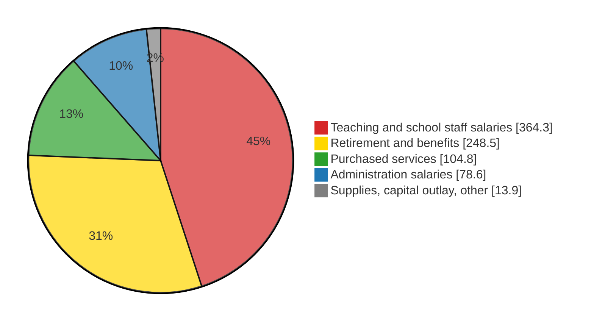

Alex Stange

# Premise

PPS proposes to close Sabin Elementary after the 2026-27 school year.  Sabin and other schools would close and send their students to other schools, and still other schools would have boundary changes.  The primary reason given has been to concentrate students in fewer buildings.

## Assumption of Motive

The concentration of resources is presumably to close a budget shortfall.

In a country where parents pay for smaller classes at private schools, tutors and art and music lessons, it is assumed that a school district would not choose to have larger class sizes.

It is assumed this is a recent issue. Looking back over the last few years we should see why this change is proposed now instead of in the past.

## Why Sabin?

As shown in [astange/sabin_tax_report](https://github.com/astangepdx/sabin_tax_report), the Sabin catchment area contributed $6.7M to PPS in property taxes in 2025.  This amount has increased at 5.2% annualized since 2021, outpacing inflation measures.  This is not meant to imply that Sabin catchment area taxes are only for Sabin Elementary.  It is meant to imply that taxpayers in the Sabin catchment area have are paying for a level of service from Portland Public Schools that is decreasing, and PPS is not offering to reduce taxes.  Why are we getting less service for the same money?

Less compared to when?  I chose to look at the years 2021 through 2025.  Presumably something has happened relatively recently that requires closing Sabin and many other schools.

Obviously if the PPS district's tax collection has decreased that would explain the cut.  If that is the case Sabin's increase in tax collection is an outlier.

If tax collection has not decreased, then the money is the same and must be going somewhere else.  Some possibilities:

- PPS costs have increased 
- Redistribution - PPS receives proportionally less state funding than other districts, effectively making PPS taxpayers subsidize other school districts in the state
- Waste
- Fraud
- Expiration of temporary funding sources

Here are some notes on each.

# Property Tax Collection

This section reports property tax collection from the Sabin catchment area and from the district as a whole.

## Property Tax Line Items

The following line items appear on all but a few percent of property tax statements in the Sabin catchment area: 

- `PPS` = `PORTLAND PUBLIC SCHOOLS`: The district’s permanent-rate operating levy, funding general school operations such as staffing and instruction.
- `PPS_LOC_OPT` = `PORTLAND PUBLIC SCHOOLS LOC OPT`: A voter-approved, temporary levy that adds operating money beyond the permanent rate.
- `PPS_BONDS` = `PORTLAND PUBLIC SCHOOLS BONDS`: Voter-approved borrowing, repaid through taxes, paying for building construction, renovation and repairs.

## Compound Annual Growth Rate Calculation

CAGR is calculated as follows:

```
T_a      = line total in start tax year a
T_b      = line total in end tax year b
n        = b − a                              # number of years
G_yoy    = T_b / T_a − 1                      # when n = 1
G_cagr   = (T_b / T_a) ^ (1/n) − 1            # when n > 1
```

## PPS District Collection

[Table](#district_tax) shows the district-wide collection data[^2][^3][^4] Tax year N funds PPS fiscal year N/N+1.  It also reports the year-on-year percent change (YoY) and the compound annual growth rate (CAGR).

| **Tax year** | **`PPS` (\$M)** | **YoY** | **`PPS_LOC_OPT` (\$M)** | **YoY** | **`PPS_BONDS` (\$M)** | **YoY** |
| :-------: | :-------: | :-----: | :-------: | :-----: | :-------: | :-----: |
| 2021 | 300 | | 105 | | 142 | |
| 2022 | 312 | +4.0% | 109 | +3.8% | 146 | +2.8% |
| 2023 | 340 | +9.0% | 107 | −1.8% | 158 | +8.2% |
| 2024 | 348 | +2.4% | 104 | −2.8% | 157 | −0.6% |
| 2025* | 360 | +3.4% | 109 | +4.8% | 174 | +10.8% |
| 2021→2025 CAGR | | +4.7%/yr | | +0.9%/yr | | +5.2%/yr |

Table district_tax: District-wide PPS property tax.

## Collection Summary

`PORTLAND PUBLIC SCHOOLS BONDS` is budgeted separately from the operational funds.  Collection of that tax is for completeness.  It increased 2021-2025.

`PORTLAND PUBLIC SCHOOLS` and `PORTLAND PUBLIC SCHOOLS LOC OPT` are of interest for this report.  They both increased modestly 2021-2025.  Funding has not decreased, so there must be a cause for reduced service.

# Causes

The following sections take up the candidate causes.

The period is FY 2021-22 → FY 2025-26 unless noted (tax year N funds FY N/N+1).

All multi-year rates are compound annual growth rates - [CAGR](#compound-annual-growth-rate-calculation)

## Increased cost

District General Fund expenditures (the operating budget), every dollar, by object. FY 2022-23 is the earliest audited year with object detail; FY 2025-26 is the adopted budget.

[Table](#gf_expenditures) lists the dollar amounts from the District General Fund to different costs in FY 2025-26, and their CAGR in the 3 years since FY 2022-23.

| **Category** | **FY 2025-26 Cost** | **Cost CAGR since FY 2022-23** |
|---------------------|:--:|:--:|
| Teaching and school staff salaries (licensed, classified, substitutes/extra duty) | $ 364M | +3.1%/yr |
| Retirement and benefits (PERS incl. pension-bond charges, health, FICA) | $ 248M | +9.6 %/yr |
| Purchased services (contracts, utilities, transportation) | $ 104M | −0.6 %/yr |
| Administration salaries (administrators, non-represented staff) | $ 78M | +4.5 %/yr |
| Supplies, capital outlay, other | $ 13M | −18.9 %/yr |
| **Total General Fund expenditures** | **$ 810M** | **+3.9 %/yr** |

Table gf_expenditures: General Fund expenditures by object.

Excludes transfers and contingency.[^5] Components may not sum to the total due to rounding.



Figure gf_pie: FY 2025-26 District General Fund expenditures by category (\$M).

| **Series** | **Period** | **CAGR** |
|--------|--------|---:|
| District `PPS` received | tax years 2021→2025 | +4.7%/yr |
| District `PPS_LOC_OPT` received | tax years 2021→2025 | +0.9%/yr |
| District `PPS_BONDS` received | tax years 2021→2025 | +5.2%/yr |
| District General Fund expenditures | FY 2022-23→FY 2025-26 | +3.9%/yr |

Table growth_compare: Tax growth vs. expenditure growth.

### Conclusion

District General Fund expenditure growth is in line with the growth in PPS tax collections.[^5][^14]
Increased cost against the District General Fund would not explain a widening funding gap forcing school closures.

---

## Redistribution

This section attempts to calcuate the amount of money Portland Public Schools gets from the State General Fund.  The State General Fund for schools is budgeted by state lawmakers and funded primarily through income tax, lottery and other consumption taxes.

### Exercise

The state counts PPS's permanent rate tax as local formula revenue and lowers the state grant by the same amount, so PPS residents fund a larger share of the statewide pot than PPS's share of students. The excess is the transfer to other districts. The formulas below are worked for tax year 2025; [Table](#transfer) gives every year.

### Calculations

#### Revenue
First, the state determines the PPS local revenue in the state funding formula, `L_pps`.

| **Symbol** | **Description** | **Value** |
|:------:|-------------|:-----:|
| `T_line` | `PORTLAND_PUBLIC_SCHOOLS` received, district-wide | [Table](#district_tax), `PPS` |
| `r_perm` | PPS permanent rate, \$ per \$1,000 AV | 4.7743 |
| `r_line` | PPS full rate (permanent + gap) | 5.2781 |

Table sym_l_pps: Data for L_pps.

```
L_pps = T_line × r_perm / r_line
      = $ 360M × 4.7743 / 5.2781
      = $ 326M
```

In 2025, the state formula says PPS local revenue for the funding formula is `$ 326M`.


Oregon compares this to the statewide local revenue to determine PPS share of statewide local revenue, `S_local`.

| **Symbol** | **Description** | **Value** |
|:------:|-------------|-------|
| `L_state` | All districts' local formula revenue statewide | $ 2,576M[^17][^19][^20] |

Table sym_s_local: Data for S_local.

```
S_local = L_pps / L_state
        = $326M / $2,576M
        = 12.7%
```

#### Students

ADMw is Average Daily Membership, weighted: student enrollment with extra weight for special education, English learners, poverty and similar factors. "Extended" ADMw is the higher of the current and prior year.

`S_admw` represents PPS share of statewide weighted students.

| **Symbol** | **Description** | **Value** |
|:------:|-------------|-------|
| `ADMw_pps` | PPS extended weighted students | 52,441[^15][^16] |
| `ADMw_state` | Statewide extended weighted students | 665,548[^15][^16] |

Table sym_s_admw: Data for S_admw.

```
S_admw = ADMw_pps / ADMw_state
       = 52,441 / 665,548
       = 7.9%
```

#### Funding

| **Symbol** | **Description** | **Value** |
|:------:|-------------|-------|
| `Fair` | PPS contribution if proportional to students | Calculated below |

Table sym_fair: Symbols for Fair.

```
Fair = S_admw × L_state
     = 7.9% × $2,576M
     = $204M
```

| **Symbol** | **Description** | **Value** |
|:------:|-------------|-------|
| `Excess` | Amount transferred to other districts | Calculated below |

Table sym_excess: Symbols for Excess.

```
Excess = L_pps − Fair
       = $326M − $204M
       = $122M
```

| **Symbol** | **Description** | **Value** |
|:------:|-------------|-------|
| `Share_of_line` | `Excess` as a fraction of the PPS line | Calculated below |

Table sym_share_of_line: Symbols for Share_of_line.

```
Share_of_line = Excess / T_line
              = $122M / $360M
              = 33.9%
```

| **Tax year** | **PPS share of local** | **PPS share of ADMw** | **Excess (\$M)** | **Excess as % of PPS line** |
| :-: | :-: | :-: | :-: | :-: |
| 2021 | 12.6% | 8.2% | 95 | 31.7% |
| 2022 | 12.4% | 8.0% | 100 | 32.1% |
| 2023 | 13.1% | 8.0% | 119 | 35.0% |
| 2024 | 12.8% | 7.9% | 121 | 34.8% |
| 2025* | 12.7% | 7.9% | 122 | 33.9% |

Table transfer: PPS transfer to other districts.

About a third of the PPS line funds other districts. PPS line from [Table](#district_tax); statewide local revenue and ADMw from ODE and Legislative Revenue Office.[^14][^15][^16][^17] Common School Fund and other minor local items (about 2% of local revenue) are omitted. Tax year N = FY N/N+1.

\* PPS line is the adopted budget; statewide local revenue is ODE's estimate.

---

## Waste

Scope: General Fund money (where the PPS line and local option are deposited) spent on something other than operations, principally construction overruns.

| **Bond program** | **General Fund contribution** | **Source statement** |
|--------------|---------------------------|------------------|
| 2012 bond (\$97.4M overrun) | Not itemized; part of \$28.7M pooled with grants and donations | Bond audit, Oct. 2026, p. 34 |
| 2017 bond (\$913M available) | Not itemized; "general fund and grants" listed among funding sources | Bond audit, Oct. 2026, p. 16 |
| 2020 and 2025 bonds | None reported | Bond audit, Oct. 2026 |

Table bond_gf: General Fund money in bond construction.

Per the independent bond performance audits.[^18] The audits do not break out the General Fund amount; the October 2026 audit recommends that the Board's internal auditor review General Fund transfers. In FY 2025-26 the documented flow ran the other way: \$1.6M of General Fund costs were moved onto the bond, \$193,400 of it ruled unallowable.

---

## Fraud

None alleged. Independent audits give unmodified opinions; the FY 2025 audit reported six significant control deficiencies and one Local Budget Law violation, attributed to staff turnover.[^6][^7][^11]

---

## One-time money expired

| **Item** | **Amount (\$M)** |
|------|---:|
| Federal ESSER relief spent on ongoing programs, FY 2020-21 → FY 2023-24 | ~115 |
| General Fund beginning reserve, FY 2023-24 → FY 2026-27 | 105.5 → 41.0 |
| PERS rate stabilization reserve, transferred and spent FY 2025-26 | ~24 |

Table one_time: One-time resources.

From the TSCC budget review, Portland Civic Lab and the PPS proposed budget.[^7][^12][^13]

[^1]: [sabin_tax_report](https://github.com/astangepdx/sabin_tax_report), `data/pps_tax_by_year.csv`.
[^2]: TSCC, [Budget Review FY 2023-24: Portland Public Schools](https://www.tsccmultco.com/wp-content/uploads/FY24-Portland-Public-Schools-Budget-Review.pdf) — tax year 2021 (FY 2021-22 actual).
[^3]: TSCC, [Budget Review FY 2025-26: Portland Public Schools](https://www.tsccmultco.com/wp-content/uploads/Portland-Public-School-District-FY-26-Budget-Review.pdf) — tax years 2022–2023 (actual) and 2025 (approved budget).
[^4]: PPS, [FY 2026-27 Proposed Budget, Vol. 1](https://resources.finalsite.net/images/v1777476167/ppsnet/cjslvvkzotwvwencttvx/2026-27ProposedBudget-Volume1.pdf), pp. 28, 30 — tax year 2024 (FY 2024-25 actual).
[^5]: PPS, [FY 2026-27 Proposed Budget, Vol. 1](https://resources.finalsite.net/images/v1777476167/ppsnet/cjslvvkzotwvwencttvx/2026-27ProposedBudget-Volume1.pdf), p. 29.
[^6]: TSCC, [Budget Review FY 2023-24: Portland Public Schools](https://www.tsccmultco.com/wp-content/uploads/FY24-Portland-Public-Schools-Budget-Review.pdf).
[^7]: TSCC, [Budget Review FY 2025-26: Portland Public Schools](https://www.tsccmultco.com/wp-content/uploads/Portland-Public-School-District-FY-26-Budget-Review.pdf), pp. 1, 7, 10–11, 18.
[^11]: Talbot, Korvola & Warwick, [FY 2025 audit communications](https://www.pps.net/fs/resource-manager/view/11756a72-66a0-4faa-a425-2cc1bbc8bc65).
[^12]: Portland Civic Lab, [Where the next dollar goes: the PPS budget, examined](https://www.portlandciviclab.org/deep-dives/pps-budget), Section 4.
[^13]: PPS, FY 2026-27 Proposed Budget, Vol. 1, p. 28.
[^14]: Tax figures from [Table](#district_tax) of this report.
[^15]: Legislative Revenue Office, [School Finance Distribution 2021-22 through 2024-25, Simulation 2023 #2](https://apps.oregonlegislature.gov/liz/2023R1/Downloads/CommitteeMeetingDocument/274520) — statewide and PPS extended ADMw, FY 2021-22 and 2022-23.
[^16]: Legislative Revenue Office, [School Finance Distribution 2023-24 through 2026-27, Simulation 2025 #1](https://apps.oregonlegislature.gov/liz/2025R1/Downloads/MeasureAnalysisDocument/92719) — statewide and PPS extended ADMw, FY 2023-24 through 2025-26.
[^17]: Statewide district local revenue: FY 2021-22 from [LRO, K-12 funding presentation, Sept. 2023](https://olis.oregonlegislature.gov/liz/2023I1/Downloads/CommitteeMeetingDocument/284187); FY 2022-23 from [ODE 2022-23 SSF estimate, May 2024](https://oregon.gov/ode/schools-and-districts/grants/Documents/2022%20-%2023%20State%20school%20fund/22-23%20District%20Estimate%205-3-24.pdf); FY 2023-24 from [ODE 2023-24 SSF estimate, May 2024](https://oregon.gov/ode/schools-and-districts/grants/Documents/2023-24%20State%20School%20Fund/23-24%20Estimate%205-3-24.pdf); FY 2024-25 from [ODE 2024-25 SSF estimate, June 2024](https://oregon.gov/ode/schools-and-districts/grants/Documents/2024-25%20State%20School%20Fund/24-25%20Estimate%206-20-24.pdf); FY 2025-26 from [ODE 2025-26 SSF estimate, March 2025](https://loswegok12.granicus.com/MetaViewer.php?view_id=3&clip_id=911&meta_id=66064).
[^18]: Sjoberg Evashenk Consulting, [Annual Bond Performance Audit, FY 2024-25 and 2025-26](https://resources.finalsite.net/images/v1791396261/ppsnet/qf1mtv3oygjz9p59ajha/PPSBondPerformanceAuditReportforFY24-25andFY25-26.pdf), Oct. 6, 2026, pp. 2, 14, 16–17, 24–31, 34.
[^19]: From ODE's estimate. Common School Fund and other minor local items (about 2% of local revenue) are omitted. Tax year N = FY N/N+1.
[^20]: PPS line is the adopted budget; statewide local revenue is ODE's estimate.
