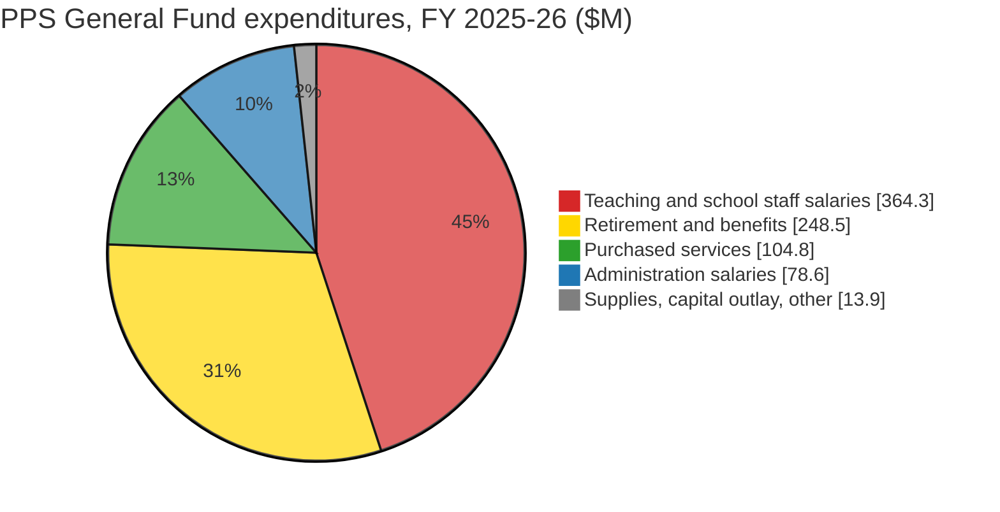

# PPS property tax, Sabin and district-wide, and where the money goes, 2021–2025

## 1. Sabin area

| Tax year | PPS line<br>($M) | % | Local option<br>($M) | % | Bonds<br>($M) | % |
|:--------:|---------:|---:|---------:|---:|---------:|---:|
| 2021 | 2.9 | | 1.2 | | 1.3 | |
| 2022 | 3.0 | +4.4% | 1.2 | +3.8% | 1.4 | +3.0% |
| 2023 | 3.3 | +9.7% | 1.3 | +3.4% | 1.5 | +8.5% |
| 2024 | 3.5 | +4.9% | 1.3 | +3.5% | 1.5 | +2.5% |
| 2025 | 3.6 | +2.8% | 1.4 | +3.5% | 1.7 | +10.2% |
| 2021→2025 CAGR | | **+5.41%/yr** | | **+3.53%/yr** | | **+6.00%/yr** |

*Table 1-1: PPS lines billed to the 2,729 Sabin-area residences, from Multnomah County tax statements. Dollars rounded to the nearest $100,000; percentages computed from unrounded values.[^1]*

## 2. PPS district

| Tax year | PPS line<br>($M) | % | Local option<br>($M) | % | Bonds<br>($M) | % |
|:--------:|---------:|---:|---------:|---:|---------:|---:|
| 2021 | 300.1 | | 104.7 | | 142.0 | |
| 2022 | 312.3 | +4.1% | 109.2 | +4.3% | 145.8 | +2.6% |
| 2023 | 339.8 | +8.8% | 106.9 | −2.1% | 158.5 | +8.7% |
| 2024 | 347.5 | +2.3% | 104.1 | −2.6% | 157.3 | −0.7% |
| 2025* | 359.8 | +3.5% | 109.2 | +4.9% | 173.7 | +10.4% |
| 2021→2025 CAGR | | **+4.64%/yr** | | **+1.06%/yr** | | **+5.16%/yr** |

*Table 2-1: Current-year property tax received by PPS, district-wide. Tax year N funds PPS fiscal year N/N+1.[^2][^3][^4]*

\* Budgeted amount; audited actuals for fiscal year 2025-26 are not yet published.

Growth formulas. Yearly % rows are simple year-over-year change; multi-year rows are compound annual growth rates (CAGR):

```
T_a      = line total in start tax year a
T_b      = line total in end tax year b
n        = b − a                              # number of years
G_yoy    = T_b / T_a − 1                      # when n = 1
G_cagr   = (T_b / T_a) ^ (1/n) − 1            # when n > 1
```

Sections 3–7 take up the candidate causes. Dollars in $M. Period is FY 2021-22 → FY 2025-26 unless noted (tax year N funds FY N/N+1). All multi-year rates are compound annual growth rates (CAGR) as defined in Section 2.

## 3. Increased cost

General Fund expenditures (the operating budget), every dollar, by object. FY 2022-23 is the earliest audited year with object detail; FY 2025-26 is the adopted budget.

| Category | FY 2025-26<br>($M) | CAGR since<br>FY 2022-23<br>(3 yr) |
|----------|---:|---:|
| Teaching and school staff salaries (licensed, classified, substitutes/extra duty) | 364.3 | +3.07%/yr |
| Retirement and benefits (PERS incl. pension-bond charges, health, FICA) | 248.5 | +9.64%/yr |
| Purchased services (contracts, utilities, transportation) | 104.8 | −0.62%/yr |
| Administration salaries (administrators, non-represented staff) | 78.6 | +4.46%/yr |
| Supplies, capital outlay, other | 13.9 | −18.93%/yr |
| **Total General Fund expenditures** | **810.2** | **+3.86%/yr** |

*Table 3-1: General Fund expenditures by object, excluding transfers and contingency.[^5]*



*Figure 3-1: FY 2025-26 General Fund expenditures by category.*

| Series | Period | CAGR |
|--------|--------|---:|
| District PPS line received | tax years 2021→2025 | +4.64%/yr |
| District local option received | tax years 2021→2025 | +1.06%/yr |
| District bonds received | tax years 2021→2025 | +5.16%/yr |
| General Fund expenditures | FY 2022-23→FY 2025-26 | +3.86%/yr |

*Table 3-2: Property tax growth vs. General Fund expenditure growth.[^5][^14]*

General Fund expenditure growth is in line with the growth in PPS tax collections.

## 4. Redistribution

The state counts PPS's permanent-rate tax (90.5% of the PPS line) as local formula revenue and lowers the state grant by the same amount, so PPS residents fund a larger share of the statewide pot than PPS's share of students. The excess is the transfer to other districts.

ADMw is Average Daily Membership, weighted: student enrollment with extra weight for special education, English learners, poverty and similar factors. "Extended" ADMw is the higher of the current and prior year.

| Symbol | Description | Value |
|--------|-------------|-------|
| T_line | PPS line received, district-wide | Table 2-1, "PPS line" |
| r_perm | PPS permanent rate, $ per $1,000 AV | 4.7743 |
| r_line | Full PPS-line rate (permanent + gap) | 5.2781 |
| L_pps | PPS permanent-rate tax counted by the state | Table 4-1, "PPS local counted" |
| L_state | All districts' local formula revenue statewide | Table 4-1, "Statewide local" |
| ADMw_pps | PPS extended weighted students | Table 4-1, "PPS ADMw" |
| ADMw_state | Statewide extended weighted students | Table 4-1, "Statewide ADMw" |
| S_local | PPS share of statewide local revenue | Table 4-1, "PPS share of local" |
| S_admw | PPS share of statewide weighted students | Table 4-1, "PPS share of ADMw" |
| Fair | PPS contribution if proportional to students | intermediate |
| Excess | Amount transferred to other districts | Table 4-1, "Excess" |
| Share_of_line | Excess as a fraction of the PPS line | Table 4-1, "Excess as % of PPS line" |

```
L_pps         = T_line × 4.7743 / 5.2781
S_local       = L_pps / L_state
S_admw        = ADMw_pps / ADMw_state
Fair          = S_admw × L_state
Excess        = L_pps − Fair
Share_of_line = Excess / T_line
```

| Tax year | PPS local counted<br>($M) | Statewide local<br>($M) | PPS ADMw | Statewide ADMw | PPS share<br>of local | PPS share<br>of ADMw | Excess<br>($M) | Excess as %<br>of PPS line |
|:--------:|---:|---:|---:|---:|---:|---:|---:|---:|
| 2021 | 271.5 | 2,150.9 | 55,688 | 676,977 | 12.62% | 8.23% | 94.5 | 31.5% |
| 2022 | 282.5 | 2,280.2 | 53,398 | 669,241 | 12.39% | 7.98% | 100.5 | 32.2% |
| 2023 | 307.4 | 2,359.6 | 53,581 | 671,248 | 13.03% | 7.98% | 119.0 | 35.0% |
| 2024 | 314.4 | 2,456.6 | 52,999 | 668,883 | 12.80% | 7.92% | 119.7 | 34.4% |
| 2025* | 325.5 | 2,576.4 | 52,441 | 665,548 | 12.63% | 7.88% | 122.5 | 34.0% |

*Table 4-1: About a third of the PPS line funds other districts. PPS line from Table 2-1; statewide local revenue and ADMw from ODE and Legislative Revenue Office.[^14][^15][^16][^17] Common School Fund and other minor local items (about 2% of local revenue) are omitted. Tax year N = FY N/N+1.*

\* PPS line is the adopted budget; statewide local revenue is ODE's estimate.

## 5. Waste

Scope: General Fund money (where the PPS line and local option are deposited) spent on something other than operations, principally construction overruns.

| Bond program | General Fund contribution | Source statement |
|--------------|---------------------------|------------------|
| 2012 bond ($97.4M overrun) | Not itemized; part of $28.7M pooled with grants and donations | Bond audit, Oct. 2026, p. 34 |
| 2017 bond ($913M available) | Not itemized; "general fund and grants" listed among funding sources | Bond audit, Oct. 2026, p. 16 |
| 2020 and 2025 bonds | None reported | Bond audit, Oct. 2026 |

*Table 5-1: General Fund money used for bond construction, per the independent bond performance audits.[^18] The audits do not break out the General Fund amount; the October 2026 audit recommends that the Board's internal auditor review General Fund transfers. In FY 2025-26 the documented flow ran the other way: $1.6M of General Fund costs were moved onto the bond, $193,400 of it ruled unallowable.*

## 6. Fraud

None alleged. Independent audits give unmodified opinions; the FY 2025 audit reported six significant control deficiencies and one Local Budget Law violation, attributed to staff turnover.[^6][^7][^11]

## 7. One-time money expired

| Item | Amount ($M) |
|------|---:|
| Federal ESSER relief spent on ongoing programs, FY 2020-21 → FY 2023-24 | ~115 |
| General Fund beginning reserve, FY 2023-24 → FY 2026-27 | 105.5 → 41.0 |
| PERS rate stabilization reserve, transferred and spent FY 2025-26 | ~24 |

*Table 7-1: One-time resources.[^7][^12][^13]*

## Sources
[^1]: [sabin_tax_report](https://github.com/astangepdx/sabin_tax_report), `data/pps_tax_by_year.csv`.
[^2]: TSCC, [Budget Review FY 2023-24: Portland Public Schools](https://www.tsccmultco.com/wp-content/uploads/FY24-Portland-Public-Schools-Budget-Review.pdf) — tax year 2021 (FY 2021-22 actual).
[^3]: TSCC, [Budget Review FY 2025-26: Portland Public Schools](https://www.tsccmultco.com/wp-content/uploads/Portland-Public-School-District-FY-26-Budget-Review.pdf) — tax years 2022–2023 (actual) and 2025 (approved budget).
[^4]: PPS, [FY 2026-27 Proposed Budget, Vol. 1](https://resources.finalsite.net/images/v1777476167/ppsnet/cjslvvkzotwvwencttvx/2026-27ProposedBudget-Volume1.pdf), pp. 28, 30 — tax year 2024 (FY 2024-25 actual).
[^5]: PPS, [FY 2026-27 Proposed Budget, Vol. 1](https://resources.finalsite.net/images/v1777476167/ppsnet/cjslvvkzotwvwencttvx/2026-27ProposedBudget-Volume1.pdf), p. 29.
[^6]: TSCC, [Budget Review FY 2023-24: Portland Public Schools](https://www.tsccmultco.com/wp-content/uploads/FY24-Portland-Public-Schools-Budget-Review.pdf).
[^7]: TSCC, [Budget Review FY 2025-26: Portland Public Schools](https://www.tsccmultco.com/wp-content/uploads/Portland-Public-School-District-FY-26-Budget-Review.pdf), pp. 1, 7, 10–11, 18.
[^8]: PPS, FY 2026-27 Proposed Budget, Vol. 1, pp. 19, 28, 32.
[^9]: Portland Civic Lab, [Where the next dollar goes: the PPS budget, examined](https://www.portlandciviclab.org/deep-dives/pps-budget), Sections 7–8.
[^10]: Sjoberg Evashenk Consulting, [Bond Performance Audit, Year 6](https://www.pps.net/fs/resource-manager/view/360be54d-7d9e-4919-9bbc-50a519481c2c).
[^11]: Talbot, Korvola & Warwick, [FY 2025 audit communications](https://www.pps.net/fs/resource-manager/view/11756a72-66a0-4faa-a425-2cc1bbc8bc65).
[^12]: Portland Civic Lab, Where the next dollar goes, Section 4.
[^13]: PPS, FY 2026-27 Proposed Budget, Vol. 1, p. 28.
[^14]: Tax figures from Table 2-1 of this report.
[^15]: Legislative Revenue Office, [School Finance Distribution 2021-22 through 2024-25, Simulation 2023 #2](https://apps.oregonlegislature.gov/liz/2023R1/Downloads/CommitteeMeetingDocument/274520) — statewide and PPS extended ADMw, FY 2021-22 and 2022-23.
[^16]: Legislative Revenue Office, [School Finance Distribution 2023-24 through 2026-27, Simulation 2025 #1](https://apps.oregonlegislature.gov/liz/2025R1/Downloads/MeasureAnalysisDocument/92719) — statewide and PPS extended ADMw, FY 2023-24 through 2025-26.
[^17]: Statewide district local revenue: FY 2021-22 from [LRO, K-12 funding presentation, Sept. 2023](https://olis.oregonlegislature.gov/liz/2023I1/Downloads/CommitteeMeetingDocument/284187); FY 2022-23 from [ODE 2022-23 SSF estimate, May 2024](https://oregon.gov/ode/schools-and-districts/grants/Documents/2022%20-%2023%20State%20school%20fund/22-23%20District%20Estimate%205-3-24.pdf); FY 2023-24 from [ODE 2023-24 SSF estimate, May 2024](https://oregon.gov/ode/schools-and-districts/grants/Documents/2023-24%20State%20School%20Fund/23-24%20Estimate%205-3-24.pdf); FY 2024-25 from [ODE 2024-25 SSF estimate, June 2024](https://oregon.gov/ode/schools-and-districts/grants/Documents/2024-25%20State%20School%20Fund/24-25%20Estimate%206-20-24.pdf); FY 2025-26 from [ODE 2025-26 SSF estimate, March 2025](https://loswegok12.granicus.com/MetaViewer.php?view_id=3&clip_id=911&meta_id=66064).
[^18]: Sjoberg Evashenk Consulting, [Annual Bond Performance Audit, FY 2024-25 and 2025-26](https://resources.finalsite.net/images/v1791396261/ppsnet/qf1mtv3oygjz9p59ajha/PPSBondPerformanceAuditReportforFY24-25andFY25-26.pdf), Oct. 6, 2026, pp. 2, 14, 16–17, 24–31, 34.
