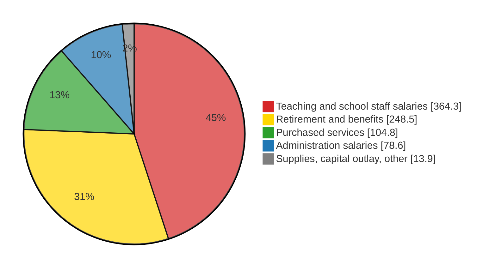

Alex Stange

# Premise

PPS proposes to close Sabin Elementary after the 2026-27 school year.  Sabin and other schools would close and send their students to other schools, and still other schools would have boundary changes.  The primary reason given has been to concentrate students in fewer buildings.

## Assumption of Motive

The concentration of resources is presumably to close a budget shortfall.

In a country where parents pay for smaller classes at private schools, tutors and art and music lessons, it is assumed that a school district would not choose to have larger class sizes.

It is assumed this is a recent issue. Looking back over the last few years we should see why this change is proposed now instead of in the past.

## Why Sabin?

As shown in [astange/sabin_tax_report](https://github.com/astangepdx/sabin_tax_report), the Sabin catchment area contributed $6.7M to PPS in property taxes in 2025.  This amount has increased at 5.2% annualized since 2021, outpacing inflation measures.  This is not meant to imply that Sabin catchment area taxes are only for Sabin Elementary.  It is meant to imply that taxpayers in the Sabin catchment area have are paying for a level of service from Portland Public Schools that is decreasing, and PPS is not offering to reduce taxes.  Why are we getting less service for the same money?

Less compared to when?  I chose to look at the years 2021 through 2025.  Presumably something has happened relatively recently that requires closing Sabin and many other schools.

Obviously if the PPS district's tax collection has decreased that would explain the cut.  If that is the case Sabin's increase in tax collection is an outlier.

If tax collection has not decreased, then the money is the same and must be going somewhere else.  Some possibilities:

- PPS costs have increased 
- Redistribution - PPS receives proportionally less state funding than other districts, effectively making PPS taxpayers subsidize other school districts in the state
- Waste
- Fraud
- Expiration of temporary funding sources

Here are some notes on each.

# Property Tax Collection

This section reports property tax collection from the Sabin catchment area and from the district as a whole.

## Property Tax Line Items

The following line items appear on all but a few percent of property tax statements in the Sabin catchment area: 

- `PPS` = `PORTLAND PUBLIC SCHOOLS`: The district’s permanent-rate operating levy, funding general school operations such as staffing and instruction.
- `PPS_LOC_OPT` = `PORTLAND PUBLIC SCHOOLS LOC OPT`: A voter-approved, temporary levy that adds operating money beyond the permanent rate.
- `PPS_BONDS` = `PORTLAND PUBLIC SCHOOLS BONDS`: Voter-approved borrowing, repaid through taxes, paying for building construction, renovation and repairs.

## Compound Annual Growth Rate Calculation

CAGR is calculated as follows:

```
T_a      = line total in start tax year a
T_b      = line total in end tax year b
n        = b − a                              # number of years
G_yoy    = T_b / T_a − 1                      # when n = 1
G_cagr   = (T_b / T_a) ^ (1/n) − 1            # when n > 1
```

## PPS District Collection

[Table](#district_tax) shows the district-wide collection data[^1][^2][^3] Tax year N funds PPS fiscal year N/N+1.  It also reports the year-on-year percent change (YoY) and the compound annual growth rate (CAGR).

| **Tax year** | **`PPS` (\$M)** | **YoY** | **`PPS_LOC_OPT` (\$M)** | **YoY** | **`PPS_BONDS` (\$M)** | **YoY** |
| :-------: | :-------: | :-----: | :-------: | :-----: | :-------: | :-----: |
| 2021 | 300 | | 105 | | 142 | |
| 2022 | 312 | +4.0% | 109 | +3.8% | 146 | +2.8% |
| 2023 | 340 | +9.0% | 107 | −1.8% | 158 | +8.2% |
| 2024 | 348 | +2.4% | 104 | −2.8% | 157 | −0.6% |
| 2025* | 360 | +3.4% | 109 | +4.8% | 174 | +10.8% |
| 2021→2025 CAGR | | +4.7%/yr | | +0.9%/yr | | +5.2%/yr |

Table district_tax: District-wide PPS property tax.

## Collection Summary

`PORTLAND PUBLIC SCHOOLS BONDS` is budgeted separately from the operational funds.  Collection of that tax is for completeness.  It increased 2021-2025.

`PORTLAND PUBLIC SCHOOLS` and `PORTLAND PUBLIC SCHOOLS LOC OPT` are of interest for this report.  They both increased modestly 2021-2025.  Funding has not decreased, so there must be a cause for reduced service.

# Causes

The following sections take up the candidate causes.

The period is FY 2021-22 → FY 2025-26 unless noted (tax year N funds FY N/N+1).

All multi-year rates are compound annual growth rates - [CAGR](#compound-annual-growth-rate-calculation)

## Increased cost

District General Fund expenditures (the operating budget), every dollar, by object. FY 2022-23 is the earliest audited year with object detail; FY 2025-26 is the adopted budget.

[Table](#gf_expenditures) lists the dollar amounts from the District General Fund to different costs in FY 2025-26, and their CAGR in the 3 years since FY 2022-23.

| **Category** | **FY 2025-26 Cost** | **Cost CAGR since FY 2022-23** |
|---------------------|:--:|:--:|
| Teaching and school staff salaries (licensed, classified, substitutes/extra duty) | $ 364M | +3.1%/yr |
| Retirement and benefits (PERS incl. pension-bond charges, health, FICA) | $ 248M | +9.6 %/yr |
| Purchased services (contracts, utilities, transportation) | $ 104M | −0.6 %/yr |
| Administration salaries (administrators, non-represented staff) | $ 78M | +4.5 %/yr |
| Supplies, capital outlay, other | $ 13M | −18.9 %/yr |
| **Total General Fund expenditures** | **$ 810M** | **+3.9 %/yr** |

Table gf_expenditures: General Fund expenditures by object.

Excludes transfers and contingency.[^3] Components may not sum to the total due to rounding.



Figure gf_pie: FY 2025-26 District General Fund expenditures by category (\$M).

| **Series** | **Period** | **CAGR** |
|--------|--------|---:|
| District `PPS` received | tax years 2021→2025 | +4.7%/yr |
| District `PPS_LOC_OPT` received | tax years 2021→2025 | +0.9%/yr |
| District `PPS_BONDS` received | tax years 2021→2025 | +5.2%/yr |
| District General Fund expenditures | FY 2022-23→FY 2025-26 | +3.9%/yr |

Table growth_compare: Tax growth vs. expenditure growth.

### Conclusion

District General Fund expenditure growth is in line with the growth in PPS tax collections.[^3]
Increased cost against the District General Fund would not explain a widening funding gap forcing school closures.

---

## Redistribution

See [Statute Annotations](#statute-annotations).

---

## Waste

Scope: General Fund money (where the PPS line and local option are deposited) spent on something other than operations, principally construction overruns.

| **Bond program** | **General Fund contribution** | **Source statement** |
|--------------|---------------------------|------------------|
| 2012 bond (\$97.4M overrun) | Not itemized; part of \$28.7M pooled with grants and donations | Bond audit, Oct. 2026, p. 34 |
| 2017 bond (\$913M available) | Not itemized; "general fund and grants" listed among funding sources | Bond audit, Oct. 2026, p. 16 |
| 2020 and 2025 bonds | None reported | Bond audit, Oct. 2026 |

Table bond_gf: General Fund money in bond construction.

Per the independent bond performance audits.[^4] The audits do not break out the General Fund amount; the October 2026 audit recommends that the Board's internal auditor review General Fund transfers. In FY 2025-26 the documented flow ran the other way: \$1.6M of General Fund costs were moved onto the bond, \$193,400 of it ruled unallowable.

---

## Fraud

None alleged. Independent audits give unmodified opinions; the FY 2025 audit reported six significant control deficiencies and one Local Budget Law violation, attributed to staff turnover.[^1][^2][^5]

---

## One-time money expired

| **Item** | **Amount (\$M)** |
|------|---:|
| Federal ESSER relief spent on ongoing programs, FY 2020-21 → FY 2023-24 | ~115 |
| General Fund beginning reserve, FY 2023-24 → FY 2026-27 | 105.5 → 41.0 |
| PERS rate stabilization reserve, transferred and spent FY 2025-26 | ~24 |

Table one_time: One-time resources.

From the TSCC budget review, Portland Civic Lab and the PPS proposed budget.[^2][^6][^3]

# Statute Annotations

Text of ORS 327.008, 327.013 and 327.011 (2023 edition with 2024 changes, as published at oregon.public.law; official source https://www.oregonlegislature.gov/bills_laws/ors/ors327.html)

The statutes are ordered 327.013, 327.011, 327.008 so each value is computed before it is used. Statute text is quoted; each quoted provision is followed by the symbols, values and formulas it defines. A symbol is defined, with a comment, where it first appears.

Values are for tax year 2025 (FY 2025-26) unless noted. Statute text is unchanged; cross-reference links inside the statute are dropped for readability.

---

## ORS 327.013 — State School Fund distribution computations for school districts

> The State School Fund distributions for school districts include the following grants:

### (1) General Purpose Grant

> General Purpose Grant = Funding Percentage × Target Grant × District extended ADMw. For the purpose of the calculation made under this subsection:

```
GPG_pps   = general purpose grant to PPS
F         = funding percentage, computed in (1)(a)
TG_pps    = target grant for PPS, computed in (1)(b)
ADMw_pps  = PPS extended weighted average daily membership, computed in (1)(c)
Rate_ADMw = general purpose grant per extended ADMw, computed in (1)(a)

GPG_pps = F × TG_pps × ADMw_pps
        = Rate_ADMw × ADMw_pps         # F × TG_pps published only as the product Rate_ADMw
        = $11,834 × 52,441
        ≈ $621M
```

> (a) The funding percentage shall be calculated by the Superintendent of Public Instruction to distribute as nearly as practicable the total sum of money available for distribution.

```
Pot           = total sum of money available for distribution to districts
SSF_districts = the part of SSF distributed to school districts in the year, 
                after ESD share and set-asides
L_state       = all districts' local revenue, 
                computed in 327.011, summed
ADMw_state    = statewide extended weighted average daily membership, computed in (1)(c)

Pot           = SSF_districts + L_state
              = $7,876M                # FY 2025-26, LRO
L_state       = $2,576M                # ODE estimate
SSF_districts = Pot − L_state
              = $5,300M
Rate_ADMw     = Pot / ADMw_state
              = $7,876M / 665,548
              = $11,834
F             = Rate_ADMw / TG_pps     # chosen so Σ GPG over all districts = Pot
```

Pot from LRO;[^7] L_state from ODE.[^8]

> (b) Target Grant = Statewide Target per ADMw Grant + Teacher Experience Factor. For the purpose of the calculation made under this paragraph:

```
STG     = statewide target per ADMw grant, (A)
TEF_pps = teacher experience factor for PPS, (B)

TG_pps = STG + TEF_pps
```

> (A) Statewide Target per ADMw Grant = $4,500.

```
STG = $4,500
```

> (B) Teacher Experience Factor = $25 × {District average teacher experience − statewide average teacher experience}. As used in this subparagraph, "average teacher experience" means the average, in years, of teaching experience of licensed teachers as reported to the Department of Education.

```
exp_pps   = PPS average licensed-teacher experience, years      # not published
exp_state = statewide average licensed-teacher experience, years # not published

TEF_pps = $25 × (exp_pps − exp_state)
```

> (c) District extended ADMw = ADMw or ADMw of the prior year, whichever is greater. The calculation of the district extended ADMw must be made as provided by ORS 338.155 if a public charter school is located in the school district. For the purpose of this paragraph:

```
ADMw_pps   = max(ADMw this year, ADMw prior year) for PPS
           = 52,441                   # FY 2025-26, LRO
ADMw_state = Σ over all districts of max(ADMw this year, ADMw prior year)
           = 665,548                  # FY 2025-26, LRO
```

ADMw from LRO.[^7]

> (A) Weighted average daily membership or ADMw = average daily membership + an additional amount computed as follows:
>
> (i) 1.0 for each student in average daily membership eligible for special education as a child with a disability under ORS 343.035, which may not exceed 11 percent of the district's ADM without review and approval by the Department of Education. Children with disabilities eligible for special education in adult local correctional facilities, as defined in ORS 169.005, or adult regional correctional facilities, as defined in ORS 169.620, may not be included in the calculation made under this sub-subparagraph.
>
> (ii) 0.5 for each student in average daily membership eligible for and enrolled in an English language learner program under ORS 336.079.
>
> (iii) 0.2 for each student in average daily membership enrolled in a union high school district or in an area of a unified school district where the district is only responsible for educating students in grades 9 through 12 in that area.
>
> (iv) −0.1 for each student in average daily membership enrolled in an elementary district operating kindergarten through grade six or kindergarten through grade eight or in an area of a unified school district where the district is only responsible for educating students in kindergarten through grade eight.
>
> (v) 0.25 times the sum of the following: (I) The number of students who are in average daily membership and who are also in poverty families, as determined by the Department of Education based on rules adopted by the State Board of Education that incorporate poverty data published by the United States Census Bureau, student data provided by school districts and other data identified by the board; (II) The number of children in foster homes in the district as determined by the report of the Department of Human Services to the United States Department of Education, "Annual Statistical Report on Children in Foster Homes and Children in Families Receiving AFDC Payments in Excess of the Poverty Income Level," or its successor, for October 31 of the year prior to the year of distribution; and (III) The number of children in the district in state-recognized facilities for neglected and delinquent children, based on information from the Department of Human Services for October 31 of the year prior to the year of distribution.
>
> (vi) The amount determined under ORS 327.077 for each remote small elementary school and for each small high school in the district.

```
ADM         = average daily membership, unweighted student count
SpEd        = students eligible for special education, capped at 0.11 × ADM
ELL         = students enrolled in an English language learner program
HS_only     = students in grades 9–12 where the district serves only 9–12
Elem_only   = students in K–6 or K–8 where the district serves only those grades
Poverty     = students in poverty families
Foster      = children in foster homes
ND          = children in facilities for neglected and delinquent children
RemoteSmall = remote small elementary and small high school amount, ORS 327.077

ADMw = ADM
     + 1.0  × SpEd
     + 0.5  × ELL
     + 0.2  × HS_only
     − 0.1  × Elem_only
     + 0.25 × (Poverty + Foster + ND)
     + RemoteSmall
```

> (B) All numbers of children used for the computation in this paragraph must reflect any district consolidations that have occurred since the numbers were compiled.

> (C) The total additional weight that shall be assigned to any student in average daily membership in a district, exclusive of students described in subparagraph (A)(v) and (vi) of this paragraph, may not exceed 2.0.

```
1.0 × SpEd + 0.5 × ELL + 0.2 × HS_only − 0.1 × Elem_only ≤ 2.0   # per student
```

### (2) High cost disabilities grant

> High cost disabilities grant = the total amount received by a school district under ORS 327.348 for providing special education and related services to resident pupils with disabilities.

```
HCD_pps = high cost disabilities grant to PPS   # not published
```

### (3) Transportation grant

> (a) Transportation grant equals: (A) 70 percent of approved transportation costs for those school districts ranked below the 80th percentile under paragraph (b) of this subsection. (B) 80 percent of approved transportation costs for those school districts ranked in or above the 80th percentile but below the 90th percentile under paragraph (b) of this subsection. (C) 90 percent of approved transportation costs for those school districts ranked in or above the 90th percentile under paragraph (b) of this subsection.
>
> (b) Each fiscal year, the Department of Education shall rank school districts based on the approved transportation costs per ADM of each school district, ranking the school district with the highest approved transportation costs per ADM at the top of the order.

```
TR_pps = transportation grant to PPS
TC_pps = PPS approved transportation costs                       # not published

TR_pps = {0.70 | 0.80 | 0.90} × TC_pps   # rate depends on PPS's percentile rank of TC/ADM
       ≈ $13M                            # LRO formula revenue $634M − GPG_pps
```

Formula revenue from LRO.[^7]

---

## ORS 327.011 — Description of Local Revenues for purpose of State School Fund distributions

> For the purpose of State School Fund distributions for school districts:

### (1) Local Revenues are the total of the following:

```
L_pps = PPS local revenue

L_pps = (a) + (b) + (c) + (d) + (e) + (f) + (g) + (h) + (i) − (2)(a) − (2)(b)
```

> (a) The amount of revenue offset against local property taxes as determined by the Department of Revenue under ORS 311.175 (3)(a)(A).

```
$0                                   # PPS
```

> (b) The amount of property taxes actually received by the district, including penalties and interest on taxes.

```
T_line = PPS permanent-rate property tax actually received, the PPS line
       = $360M                       # FY 2025-26 approved budget [^2]
T_lo   = PPS local option tax actually received, the PPS_LOC_OPT line
       = $109M                       # FY 2025-26 approved budget [^2]
```

> (c) The amount of revenue received by the district from the Common School Fund under ORS 327.403 to 327.410.

```
CSF_pps = Common School Fund received by PPS
        ≈ $6.6M
```

> (d) The amount of revenue received by the district from the county school fund.

```
CountyFund_pps = county school fund received by PPS   # not published
```

> (e) The amount of revenue received by the district from state managed forestlands under ORS 530.115 (1)(b) and (c).

```
$0                                   # PPS
```

> (f) Moneys received in lieu of property taxes.

```
PILT_pps = payments in lieu of property taxes received by PPS
         ≈ $0.5M
```

> (g) Federal funds received without specific application by the school district and that are not deemed under federal law to be nonsupplantable.

```
Fed_pps = unapplied-for federal funds received by PPS   # not published
```

> (h) Any positive amount obtained by subtracting the operating property taxes actually imposed by the district, based on the rate certified pursuant to ORS 310.060, from the amount that would have been imposed by the district if the district had certified the maximum rate of operating property taxes allowed by law.

```
r_perm = PPS permanent rate, the maximum operating rate allowed by law, $ per $1,000 AV
       = 4.7743
$0                                   # PPS certifies its full rate
```

> (i) Any amount distributed to the district in the prior fiscal year under ORS 327.019 (8).

```
$0                                   # PPS
```

### (2) Local Revenues do not include:

> (a) If a school district imposes local option taxes pursuant to ORS 280.040 to 280.145, an amount equal to the least of: (A) The amount of revenue actually received by the district from local option taxes imposed pursuant to ORS 280.040 to 280.145; (B) Twenty-five percent of the total received by the school district from the general purpose grant, the transportation grant and the high cost disabilities grant of the district, as those grants are calculated under ORS 327.013; or (C) $2,000 per district extended ADMw, as calculated under ORS 327.013, increased each fiscal year by three percent above the amount allowed per district extended ADMw for the prior fiscal year.

```
LO_cap = local option amount excluded from local revenue
cap_C  = $2,000 per extended ADMw, grown 3% per year  # not computed; exceeds T_lo / ADMw_pps

LO_cap = min( T_lo,
              0.25 × (GPG_pps + TR_pps + HCD_pps),
              cap_C × ADMw_pps )
       = min( $109M, ≈ $158M, > $109M )
       = $109M
```

> (b) For a school district with a statutory rate limit on July 1, 2003, that is greater than $4.50 per $1,000 of assessed value, the amount of property taxes actually received by the district, including penalties and interest on taxes, that results from an increase in the rate of ad valorem property tax of the district allowed under Article XI, section 11 (5)(d), of the Oregon Constitution.

```
r_line = full PPS-line rate, permanent rate plus the 2009 gap increase, $ per $1,000 AV
       = 5.2781
gap    = gap-rate portion of the PPS line, excluded
       = T_line × (r_line − r_perm) / r_line
       = $360M × 0.0954
       = $34M

L_pps  = T_line + T_lo + CSF_pps + CountyFund_pps + PILT_pps + Fed_pps − LO_cap − gap
       = T_line − gap                 # CSF, county fund, PILT, federal items omitted
       = T_line × r_perm / r_line
       = $360M × 0.9046
       = $326M
```

---

## ORS 327.008 — State School Fund; State School Fund grants

### (1)

> (a) There is established a State School Fund in the General Fund.

```
SSF = State School Fund, the state's K-12 appropriation
```

> (b) The Department of Education, on behalf of the State of Oregon, may solicit and accept gifts, grants, donations and other moneys from public and private sources for the State School Fund. Moneys received as provided in this paragraph shall be deposited into the State School Fund.

> (c) The State School Fund shall consist of moneys appropriated by the Legislative Assembly, moneys transferred from the Fund for Student Success, moneys transferred from the Education Stability Fund and the Oregon Marijuana Account and moneys received as provided in paragraph (b) of this subsection.

```
SSF = $11.36B                        # 2025–27 biennium, set by the Legislature [^2]
```

> (d) The State School Fund is continuously appropriated to the Department of Education for the purposes of ORS 327.006 to 327.077, 327.095, 327.099, 327.101, 327.125, 327.137, 327.348, 327.356 to 327.359, 336.575, 336.580, 336.635, 343.243, 343.533, 343.941 and 343.961.

### (2)

> There shall be apportioned from the State School Fund to each school district a State School Fund grant, consisting of the positive amount equal to a general purpose grant and a transportation grant and a high cost disabilities grant minus local revenue, computed as provided in ORS 327.011 and 327.013.

```
Grant_pps = State School Fund grant to PPS, the state check

Grant_pps = GPG_pps + TR_pps + HCD_pps − L_pps
          = $621M + $13M + HCD_pps − $326M
Grant_pps = $291M                    # PPS FY 2025-26 budget [^2]; HCD_pps not published
```

### (3)

> For the first school year after a public charter school ceases to operate because of dissolution or closure or because of termination or nonrenewal of a charter, there shall be apportioned from the State School Fund to each school district that had sponsored a public charter school that ceased to operate an amount equal to the school district's general purpose grant per extended ADMw multiplied by five percent of the ADM of the public charter school for the previous school year.

### (4)

> There shall be apportioned from the State School Fund to each education service district a State School Fund grant as calculated under ORS 327.019.

### (5)

> All figures used in the determination of the distribution of the State School Fund shall be estimates for the same year as the distribution occurs, unless otherwise specified.

### (6)

> Numbers of students in average daily membership used in the distribution formula shall be the numbers as of June of the year of distribution.

### (7) through (19)

> (7) Each biennium, the Department of Education may expend from the State School Fund no more than $3 million for expenses incurred by the department in providing support to school districts, education service districts and public charter schools at any time before, during or after a threat or hazard that may affect a school district, an education service district or a public charter school and for the purpose of helping to improve the safety and security of students and staff.
>
> (8) Each biennium, the Department of Education may expend from the State School Fund no more than $10 million for expenses incurred by the Office of School Facilities under ORS 326.125 (1)(b) to (g).
>
> (9) Each fiscal year, the Department of Education shall transfer to the Pediatric Nursing Facility Account established in ORS 327.022 the amount necessary to pay the costs of educational services provided to students admitted to pediatric nursing facilities as provided in ORS 343.941.
>
> (10) Each fiscal year, the Department of Education shall transfer the amount of $55 million from the State School Fund to the High Cost Disabilities Account established in ORS 327.348.
>
> (11)(a) Each biennium, the Department of Education shall transfer $39.5 million from the State School Fund to the Educator Advancement Fund established under ORS 342.953.
>
> (b) For the purpose of making the transfer under this subsection: (A) The total amount available for all distributions from the State School Fund shall be reduced by $6 million; (B) The amount distributed to school districts from the State School Fund under this section and ORS 327.013 shall be reduced by $16.75 million; and (C) The amount distributed to education service districts from the State School Fund under this section and ORS 327.019 shall be reduced by $16.75 million.
>
> (c) For each biennium, the amounts identified in this subsection shall be adjusted by the same percentage by which the instructions furnished to state agencies by the Governor under ORS 291.204 direct the state agencies to adjust their agency budget requests for special payments under ORS 291.216 (6)(a)(C).
>
> (12) Each biennium, the Department of Education shall transfer $12.5 million from the State School Fund to the Statewide English Language Learner Program Account established under ORS 327.344.
>
> (13) Each fiscal year, the Department of Education may expend up to $550,000 from the State School Fund for the contract described in ORS 329.488. The amount distributed to education service districts from the State School Fund under this section and ORS 327.019 shall be reduced by the amount expended by the department under this subsection.
>
> (14) Each biennium, the Department of Education may expend up to $350,000 from the State School Fund to provide administration of and support for the development of talented and gifted education under ORS 343.404.
>
> (15) Each biennium, the Department of Education may expend up to $150,000 from the State School Fund for the administration of a program to increase the number of licensed speech-language pathologists and certified speech-language pathology assistants under ORS 348.398.
>
> (16) Each biennium, the Department of Education shall transfer $2 million from the State School Fund for deposit to the Healthy School Facilities Fund established under ORS 332.337. Notwithstanding ORS 332.337, the department may expend moneys received in the Healthy School Facilities Fund under this subsection only as grants for costs associated with testing for elevated levels of lead in water used for drinking or food preparation.
>
> (17) Each biennium, the Department of Education shall transfer an amount not to exceed $5,595,000 for the purpose of making tampons and sanitary pads available as provided by ORS 326.545.
>
> (18) Each fiscal year, the Department of Education shall transfer the amount of $2.5 million from the State School Fund to the Small School District Supplement Fund established in ORS 327.359.
>
> (19) Each biennium, the Department of Education shall transfer to the Oregon Military Department the amount necessary to pay the costs of educational services provided to students admitted to programs operated by the military department for at-risk youth, as described in ORS 396.360, that are outstanding after any General Fund appropriations and the calculation of available federal funds for the programs.

[^1]: TSCC, [Budget Review FY 2023-24: Portland Public Schools](https://www.tsccmultco.com/wp-content/uploads/FY24-Portland-Public-Schools-Budget-Review.pdf) — tax year 2021 (FY 2021-22 actual).
[^2]: TSCC, [Budget Review FY 2025-26: Portland Public Schools](https://www.tsccmultco.com/wp-content/uploads/Portland-Public-School-District-FY-26-Budget-Review.pdf) — tax years 2022–2023 (actual) and 2025 (approved budget); pp. 1, 7–8, 10–11, 18.
[^3]: PPS, [FY 2026-27 Proposed Budget, Vol. 1](https://resources.finalsite.net/images/v1777476167/ppsnet/cjslvvkzotwvwencttvx/2026-27ProposedBudget-Volume1.pdf) — tax year 2024 (FY 2024-25 actual), pp. 28–30.
[^4]: Sjoberg Evashenk Consulting, [Annual Bond Performance Audit, FY 2024-25 and 2025-26](https://resources.finalsite.net/images/v1791396261/ppsnet/qf1mtv3oygjz9p59ajha/PPSBondPerformanceAuditReportforFY24-25andFY25-26.pdf), Oct. 6, 2026, pp. 2, 14, 16–17, 24–31, 34.
[^5]: Talbot, Korvola & Warwick, [FY 2025 audit communications](https://www.pps.net/fs/resource-manager/view/11756a72-66a0-4faa-a425-2cc1bbc8bc65).
[^6]: Portland Civic Lab, [Where the next dollar goes: the PPS budget, examined](https://www.portlandciviclab.org/deep-dives/pps-budget), Section 4.
[^7]: Legislative Revenue Office, [School Finance Distribution 2023-24 through 2026-27, Simulation 2025 #1](https://apps.oregonlegislature.gov/liz/2025R1/Downloads/MeasureAnalysisDocument/92719) — statewide and PPS extended ADMw, FY 2023-24 through 2025-26; FY 2025-26 formula revenue.
[^8]: Statewide district local revenue: FY 2021-22 from [LRO, K-12 funding presentation, Sept. 2023](https://olis.oregonlegislature.gov/liz/2023I1/Downloads/CommitteeMeetingDocument/284187); FY 2022-23 from [ODE 2022-23 SSF estimate, May 2024](https://oregon.gov/ode/schools-and-districts/grants/Documents/2022%20-%2023%20State%20school%20fund/22-23%20District%20Estimate%205-3-24.pdf); FY 2023-24 from [ODE 2023-24 SSF estimate, May 2024](https://oregon.gov/ode/schools-and-districts/grants/Documents/2023-24%20State%20School%20Fund/23-24%20Estimate%205-3-24.pdf); FY 2024-25 from [ODE 2024-25 SSF estimate, June 2024](https://oregon.gov/ode/schools-and-districts/grants/Documents/2024-25%20State%20School%20Fund/24-25%20Estimate%206-20-24.pdf); FY 2025-26 from [ODE 2025-26 SSF estimate, March 2025](https://loswegok12.granicus.com/MetaViewer.php?view_id=3&clip_id=911&meta_id=66064).
